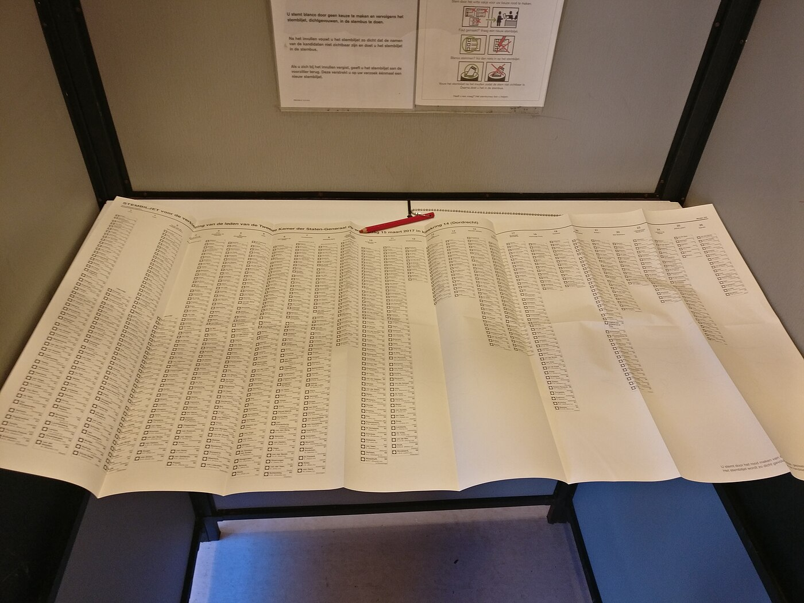
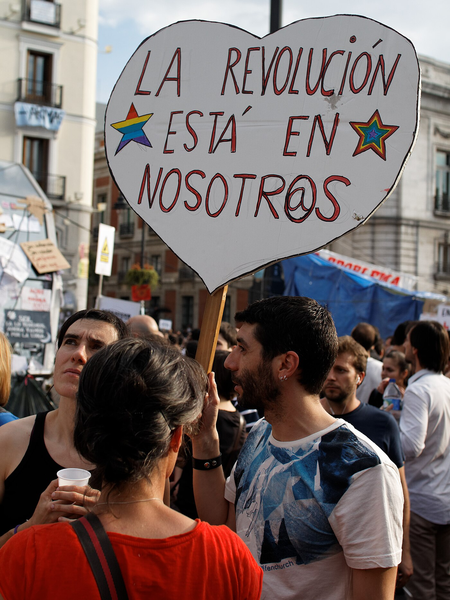
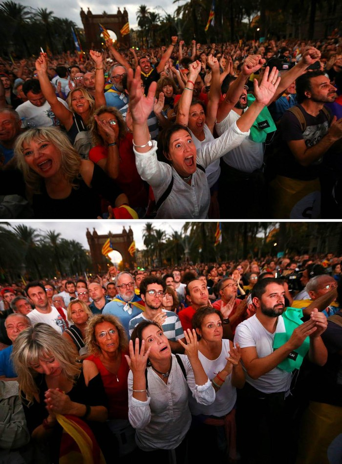
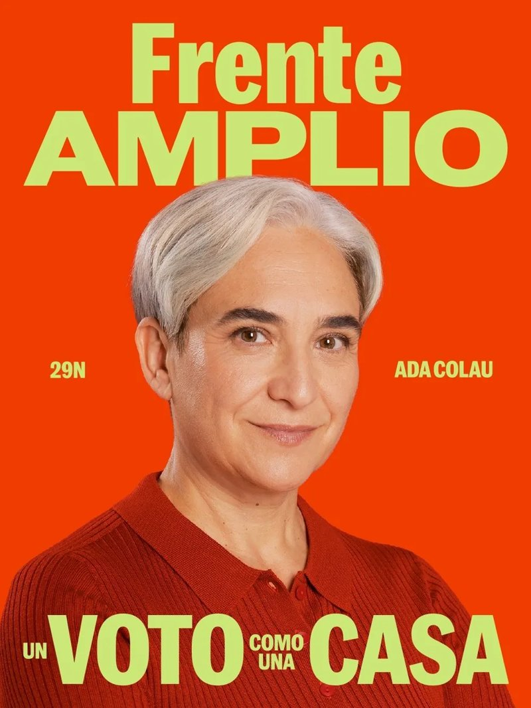
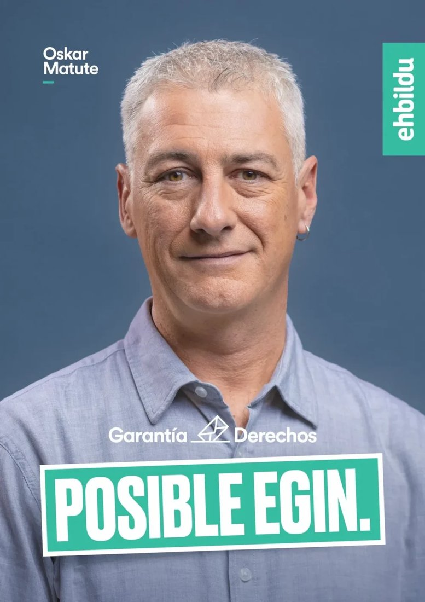
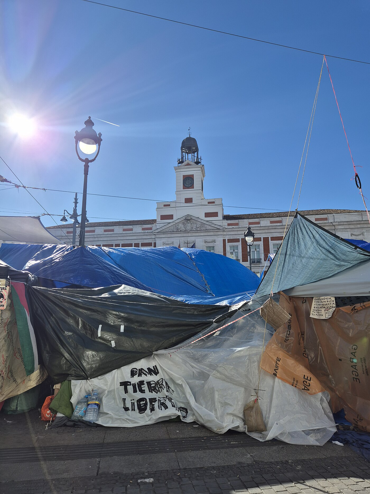
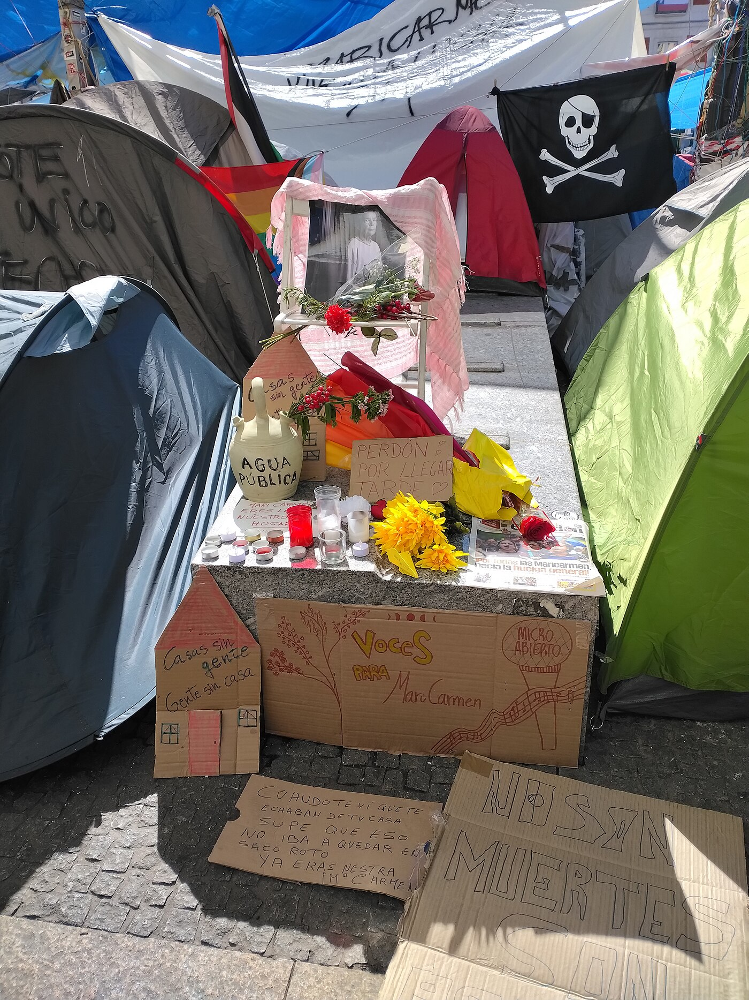

## {.divider background-color="#0E5E6F" data-background-image="img/dv_title.jpg" data-background-size="cover" data-rail="0" data-rail-label=""}

26 November 2026

<h1>Spain votes again</h1>

The road to the 29 November general election  <b style='color:#fff'>Isabela Zeberio</b> · Universiteit van Amsterdam

Photo: Puerta del Sol camp, 2026 — Raystorm, Wikimedia Commons (CC BY-SA 4.0)

## {.divider background-color="#0E5E6F"}

Part 1

<h1>How Spaniards vote</h1>

A ballot for a party, not a person, and more elections than planned.

01

How Spaniards vote

Dictatorship to fragmentation

2023 and the players

The road to the snap election

The debates

##

1 · The ballot

<h2 class="t">The ballot: for Congress you vote for a party list, not a person</h2>

ELECCIONES GENERALES 2026 <b>CONGRESO DE LOS DIPUTADOS</b> Circunscripción: MADRID

PARTY X
<ol><li>Candidate 1</li><li>Candidate 2</li><li>Candidate 3</li><li>Candidate 4</li><li>Candidate 5</li><li>Candidate 6</li><li>Candidate 7</li><li>…</li></ol>

<b>Congress</b>: closed, blocked list. One ballot in the envelope; the order of names can't be changed.

ELECCIONES GENERALES 2026 <b>SENADO</b> Mark up to 3

Party X

<i></i>Candidate X1

<i></i>Candidate X2

<i></i>Candidate X3

Party Y

<i></i>Candidate Y1

<i></i>Candidate Y2

<i></i>Candidate Y3

Party Z

<i></i>Candidate Z1

<i></i>Candidate Z2

<i></i>Candidate Z3

<b>Senate</b>: open ballot. Tick up to 3 names, even from different parties.

<h3>52 districts</h3>One per province + Ceuta and Melilla. D'Hondt, 3% threshold per district. Small provinces elect only 2–4 MPs.

NL
One national list per party, but you vote for <b>a candidate</b> (preference vote). One national district, no formal threshold.

Source: Ley Orgánica 5/1985 del Régimen Electoral General (LOREG); Ministry of the Interior; Kiesraad. Ballots shown are schematic.

##

1 · Meanwhile in the Netherlands

<h2 class="t">…while the Dutch ballot lists every candidate of every party</h2>

37

party lists on the 2021 Tweede Kamer ballot

<h3>“I could use it as…”</h3>

Source: Kiesraad (2021 Tweede Kamer election); r/europe, 'The huge Dutch election ballot' (2021).

Photo: Dutch ballot, 2017 general election — 1Veertje, Wikimedia Commons (CC BY-SA 3.0).

##

1 · Elections

<h2 class="t">Spaniards vote often, and lately more often than planned</h2>

<svg stroke="currentColor" fill="currentColor" stroke-width="0" viewBox="0 0 512 512" height="1em" width="1em" xmlns="http://www.w3.org/2000/svg"><path d="M501.62 92.11L267.24 2.04a31.958 31.958 0 0 0-22.47 0L10.38 92.11A16.001 16.001 0 0 0 0 107.09V144c0 8.84 7.16 16 16 16h480c8.84 0 16-7.16 16-16v-36.91c0-6.67-4.14-12.64-10.38-14.98zM64 192v160H48c-8.84 0-16 7.16-16 16v48h448v-48c0-8.84-7.16-16-16-16h-16V192h-64v160h-96V192h-64v160h-96V192H64zm432 256H16c-8.84 0-16 7.16-16 16v32c0 8.84 7.16 16 16 16h480c8.84 0 16-7.16 16-16v-32c0-8.84-7.16-16-16-16z"></path></svg><b>General</b>At least every 4 years; can be called earlyNext: 29 Nov 2026

<svg stroke="currentColor" fill="currentColor" stroke-width="0" viewBox="0 0 576 512" height="1em" width="1em" xmlns="http://www.w3.org/2000/svg"><path d="M288 0c-69.59 0-126 56.41-126 126 0 56.26 82.35 158.8 113.9 196.02 6.39 7.54 17.82 7.54 24.2 0C331.65 284.8 414 182.26 414 126 414 56.41 357.59 0 288 0zm0 168c-23.2 0-42-18.8-42-42s18.8-42 42-42 42 18.8 42 42-18.8 42-42 42zM20.12 215.95A32.006 32.006 0 0 0 0 245.66v250.32c0 11.32 11.43 19.06 21.94 14.86L160 448V214.92c-8.84-15.98-16.07-31.54-21.25-46.42L20.12 215.95zM288 359.67c-14.07 0-27.38-6.18-36.51-16.96-19.66-23.2-40.57-49.62-59.49-76.72v182l192 64V266c-18.92 27.09-39.82 53.52-59.49 76.72-9.13 10.77-22.44 16.95-36.51 16.95zm266.06-198.51L416 224v288l139.88-55.95A31.996 31.996 0 0 0 576 426.34V176.02c0-11.32-11.43-19.06-21.94-14.86z"></path></svg><b>Regional (17 regions)</b>Every 4 years; most with the municipal vote, some on their own datesNext: May 2027 (most)

<svg stroke="currentColor" fill="currentColor" stroke-width="0" viewBox="0 0 640 512" height="1em" width="1em" xmlns="http://www.w3.org/2000/svg"><path d="M616 192H480V24c0-13.26-10.74-24-24-24H312c-13.26 0-24 10.74-24 24v72h-64V16c0-8.84-7.16-16-16-16h-16c-8.84 0-16 7.16-16 16v80h-64V16c0-8.84-7.16-16-16-16H80c-8.84 0-16 7.16-16 16v80H24c-13.26 0-24 10.74-24 24v360c0 17.67 14.33 32 32 32h576c17.67 0 32-14.33 32-32V216c0-13.26-10.75-24-24-24zM128 404c0 6.63-5.37 12-12 12H76c-6.63 0-12-5.37-12-12v-40c0-6.63 5.37-12 12-12h40c6.63 0 12 5.37 12 12v40zm0-96c0 6.63-5.37 12-12 12H76c-6.63 0-12-5.37-12-12v-40c0-6.63 5.37-12 12-12h40c6.63 0 12 5.37 12 12v40zm0-96c0 6.63-5.37 12-12 12H76c-6.63 0-12-5.37-12-12v-40c0-6.63 5.37-12 12-12h40c6.63 0 12 5.37 12 12v40zm128 192c0 6.63-5.37 12-12 12h-40c-6.63 0-12-5.37-12-12v-40c0-6.63 5.37-12 12-12h40c6.63 0 12 5.37 12 12v40zm0-96c0 6.63-5.37 12-12 12h-40c-6.63 0-12-5.37-12-12v-40c0-6.63 5.37-12 12-12h40c6.63 0 12 5.37 12 12v40zm0-96c0 6.63-5.37 12-12 12h-40c-6.63 0-12-5.37-12-12v-40c0-6.63 5.37-12 12-12h40c6.63 0 12 5.37 12 12v40zm160 96c0 6.63-5.37 12-12 12h-40c-6.63 0-12-5.37-12-12v-40c0-6.63 5.37-12 12-12h40c6.63 0 12 5.37 12 12v40zm0-96c0 6.63-5.37 12-12 12h-40c-6.63 0-12-5.37-12-12v-40c0-6.63 5.37-12 12-12h40c6.63 0 12 5.37 12 12v40zm0-96c0 6.63-5.37 12-12 12h-40c-6.63 0-12-5.37-12-12V76c0-6.63 5.37-12 12-12h40c6.63 0 12 5.37 12 12v40zm160 288c0 6.63-5.37 12-12 12h-40c-6.63 0-12-5.37-12-12v-40c0-6.63 5.37-12 12-12h40c6.63 0 12 5.37 12 12v40zm0-96c0 6.63-5.37 12-12 12h-40c-6.63 0-12-5.37-12-12v-40c0-6.63 5.37-12 12-12h40c6.63 0 12 5.37 12 12v40z"></path></svg><b>Municipal</b>Fixed: 4th Sunday of May, every 4 yearsNext: May 2027

<svg stroke="currentColor" fill="currentColor" stroke-width="0" viewBox="0 0 496 512" height="1em" width="1em" xmlns="http://www.w3.org/2000/svg"><path d="M248 8C111 8 0 119 0 256s111 248 248 248 248-111 248-248S385 8 248 8zm200 248c0 22.5-3.9 44.2-10.8 64.4h-20.3c-4.3 0-8.4-1.7-11.4-4.8l-32-32.6c-4.5-4.6-4.5-12.1.1-16.7l12.5-12.5v-8.7c0-3-1.2-5.9-3.3-8l-9.4-9.4c-2.1-2.1-5-3.3-8-3.3h-16c-6.2 0-11.3-5.1-11.3-11.3 0-3 1.2-5.9 3.3-8l9.4-9.4c2.1-2.1 5-3.3 8-3.3h32c6.2 0 11.3-5.1 11.3-11.3v-9.4c0-6.2-5.1-11.3-11.3-11.3h-36.7c-8.8 0-16 7.2-16 16v4.5c0 6.9-4.4 13-10.9 15.2l-31.6 10.5c-3.3 1.1-5.5 4.1-5.5 7.6v2.2c0 4.4-3.6 8-8 8h-16c-4.4 0-8-3.6-8-8s-3.6-8-8-8H247c-3 0-5.8 1.7-7.2 4.4l-9.4 18.7c-2.7 5.4-8.2 8.8-14.3 8.8H194c-8.8 0-16-7.2-16-16V199c0-4.2 1.7-8.3 4.7-11.3l20.1-20.1c4.6-4.6 7.2-10.9 7.2-17.5 0-3.4 2.2-6.5 5.5-7.6l40-13.3c1.7-.6 3.2-1.5 4.4-2.7l26.8-26.8c2.1-2.1 3.3-5 3.3-8 0-6.2-5.1-11.3-11.3-11.3H258l-16 16v8c0 4.4-3.6 8-8 8h-16c-4.4 0-8-3.6-8-8v-20c0-2.5 1.2-4.9 3.2-6.4l28.9-21.7c1.9-.1 3.8-.3 5.7-.3C358.3 56 448 145.7 448 256zM130.1 149.1c0-3 1.2-5.9 3.3-8l25.4-25.4c2.1-2.1 5-3.3 8-3.3 6.2 0 11.3 5.1 11.3 11.3v16c0 3-1.2 5.9-3.3 8l-9.4 9.4c-2.1 2.1-5 3.3-8 3.3h-16c-6.2 0-11.3-5.1-11.3-11.3zm128 306.4v-7.1c0-8.8-7.2-16-16-16h-20.2c-10.8 0-26.7-5.3-35.4-11.8l-22.2-16.7c-11.5-8.6-18.2-22.1-18.2-36.4v-23.9c0-16 8.4-30.8 22.1-39l42.9-25.7c7.1-4.2 15.2-6.5 23.4-6.5h31.2c10.9 0 21.4 3.9 29.6 10.9l43.2 37.1h18.3c8.5 0 16.6 3.4 22.6 9.4l17.3 17.3c3.4 3.4 8.1 5.3 12.9 5.3H423c-32.4 58.9-93.8 99.5-164.9 103.1z"></path></svg><b>European Parliament</b>Every 5 yearsNext: 2029

General elections since 1977 · the last six in eleven years

1977

1979

1982

1986

1989

1993

1996

2000

2004

2008

2011

2015

2016

2019 Apr

2019 Nov

2023

2026

Source: Ministry of the Interior, historical election results; LOREG.

## {.divider background-color="#0E5E6F" data-rail="2.11" data-rail-label="1975"}

Part 2

<h1>From dictatorship to fragmentation</h1>

A young democracy, thirty years of alternation, then the 2011 earthquake.

02

How Spaniards vote

Dictatorship to fragmentation

2023 and the players

The road to the snap election

The debates

## {data-rail="2.11" data-rail-label="Nov 1975"}

2 · A young democracy

<h2 class="t">From dictatorship to democracy in three years</h2>

<svg stroke="currentColor" fill="currentColor" stroke-width="0" viewBox="0 0 512 512" height="1em" width="1em" xmlns="http://www.w3.org/2000/svg"><path d="M288 167.2v-28.1c-28.2-36.3-47.1-79.3-54.1-125.2-2.1-13.5-19-18.8-27.8-8.3-21.1 24.9-37.7 54.1-48.9 86.5 34.2 38.3 80 64.6 130.8 75.1zM400 64c-44.2 0-80 35.9-80 80.1v59.4C215.6 197.3 127 133 87 41.8c-5.5-12.5-23.2-13.2-29-.9C41.4 76 32 115.2 32 156.6c0 70.8 34.1 136.9 85.1 185.9 13.2 12.7 26.1 23.2 38.9 32.8l-143.9 36C1.4 414-3.4 426.4 2.6 435.7 20 462.6 63 508.2 155.8 512c8 .3 16-2.6 22.1-7.9l65.2-56.1H320c88.4 0 160-71.5 160-159.9V128l32-64H400zm0 96.1c-8.8 0-16-7.2-16-16s7.2-16 16-16 16 7.2 16 16-7.2 16-16 16z"></path></svg>
Nov 1975
<h3>Franco dies</h3>End of a 36-year dictatorship

<svg stroke="currentColor" fill="currentColor" stroke-width="0" viewBox="0 0 640 512" height="1em" width="1em" xmlns="http://www.w3.org/2000/svg"><path d="M608 320h-64v64h22.4c5.3 0 9.6 3.6 9.6 8v16c0 4.4-4.3 8-9.6 8H73.6c-5.3 0-9.6-3.6-9.6-8v-16c0-4.4 4.3-8 9.6-8H96v-64H32c-17.7 0-32 14.3-32 32v96c0 17.7 14.3 32 32 32h576c17.7 0 32-14.3 32-32v-96c0-17.7-14.3-32-32-32zm-96 64V64.3c0-17.9-14.5-32.3-32.3-32.3H160.4C142.5 32 128 46.5 128 64.3V384h384zM211.2 202l25.5-25.3c4.2-4.2 11-4.2 15.2.1l41.3 41.6 95.2-94.4c4.2-4.2 11-4.2 15.2.1l25.3 25.5c4.2 4.2 4.2 11-.1 15.2L300.5 292c-4.2 4.2-11 4.2-15.2-.1l-74.1-74.7c-4.3-4.2-4.2-11 0-15.2z"></path></svg>
Dec 1976
<h3>Political Reform Act</h3>Approved by referendum: the regime votes itself out

<svg stroke="currentColor" fill="currentColor" stroke-width="0" viewBox="0 0 512 512" height="1em" width="1em" xmlns="http://www.w3.org/2000/svg"><path d="M176 216h160c8.84 0 16-7.16 16-16v-16c0-8.84-7.16-16-16-16H176c-8.84 0-16 7.16-16 16v16c0 8.84 7.16 16 16 16zm-16 80c0 8.84 7.16 16 16 16h160c8.84 0 16-7.16 16-16v-16c0-8.84-7.16-16-16-16H176c-8.84 0-16 7.16-16 16v16zm96 121.13c-16.42 0-32.84-5.06-46.86-15.19L0 250.86V464c0 26.51 21.49 48 48 48h416c26.51 0 48-21.49 48-48V250.86L302.86 401.94c-14.02 10.12-30.44 15.19-46.86 15.19zm237.61-254.18c-8.85-6.94-17.24-13.47-29.61-22.81V96c0-26.51-21.49-48-48-48h-77.55c-3.04-2.2-5.87-4.26-9.04-6.56C312.6 29.17 279.2-.35 256 0c-23.2-.35-56.59 29.17-73.41 41.44-3.17 2.3-6 4.36-9.04 6.56H96c-26.51 0-48 21.49-48 48v44.14c-12.37 9.33-20.76 15.87-29.61 22.81A47.995 47.995 0 0 0 0 200.72v10.65l96 69.35V96h320v184.72l96-69.35v-10.65c0-14.74-6.78-28.67-18.39-37.77z"></path></svg>
Jun 1977
<h3>First free elections</h3>First democratic vote since 1936

<svg stroke="currentColor" fill="currentColor" stroke-width="0" viewBox="0 0 576 512" height="1em" width="1em" xmlns="http://www.w3.org/2000/svg"><path d="M542.22 32.05c-54.8 3.11-163.72 14.43-230.96 55.59-4.64 2.84-7.27 7.89-7.27 13.17v363.87c0 11.55 12.63 18.85 23.28 13.49 69.18-34.82 169.23-44.32 218.7-46.92 16.89-.89 30.02-14.43 30.02-30.66V62.75c.01-17.71-15.35-31.74-33.77-30.7zM264.73 87.64C197.5 46.48 88.58 35.17 33.78 32.05 15.36 31.01 0 45.04 0 62.75V400.6c0 16.24 13.13 29.78 30.02 30.66 49.49 2.6 149.59 12.11 218.77 46.95 10.62 5.35 23.21-1.94 23.21-13.46V100.63c0-5.29-2.62-10.14-7.27-12.99z"></path></svg>
Dec 1978
<h3>Constitution</h3>Approved by referendum; still in force today

<svg stroke="currentColor" fill="currentColor" stroke-width="0" viewBox="0 0 512 512" height="1em" width="1em" xmlns="http://www.w3.org/2000/svg"><path d="M500.33 0h-47.41a12 12 0 0 0-12 12.57l4 82.76A247.42 247.42 0 0 0 256 8C119.34 8 7.9 119.53 8 256.19 8.1 393.07 119.1 504 256 504a247.1 247.1 0 0 0 166.18-63.91 12 12 0 0 0 .48-17.43l-34-34a12 12 0 0 0-16.38-.55A176 176 0 1 1 402.1 157.8l-101.53-4.87a12 12 0 0 0-12.57 12v47.41a12 12 0 0 0 12 12h200.33a12 12 0 0 0 12-12V12a12 12 0 0 0-12-12z"></path></svg>
Oct 1982
<h3>First alternation</h3>PSOE wins a landslide: democracy consolidated

<h3>Part of the 'third wave'</h3>Portugal 1974, Greece 1974, Spain 1975–78: the start of Huntington's third wave of democratisation in Southern Europe.

NL
Universal suffrage since 1919. Spain's current democracy dates from <b>1977</b>.

Source: Huntington, S. P. (1991) The Third Wave: Democratization in the Late Twentieth Century; Congreso de los Diputados; Ministry of the Interior.

##

2 · The institutions

<h2 class="t">A parliamentary monarchy, like the Netherlands: the king reigns, parliament decides</h2>

<figure class="king"><figcaption>Felipe VI King of Spain since 2014</figcaption></figure>
<figure class="king"><figcaption>Willem-Alexander King of the Netherlands since 2013</figcaption></figure>

<svg stroke="currentColor" fill="currentColor" stroke-width="0" viewBox="0 0 640 512" height="1em" width="1em" xmlns="http://www.w3.org/2000/svg"><path d="M528 448H112c-8.8 0-16 7.2-16 16v32c0 8.8 7.2 16 16 16h416c8.8 0 16-7.2 16-16v-32c0-8.8-7.2-16-16-16zm64-320c-26.5 0-48 21.5-48 48 0 7.1 1.6 13.7 4.4 19.8L476 239.2c-15.4 9.2-35.3 4-44.2-11.6L350.3 85C361 76.2 368 63 368 48c0-26.5-21.5-48-48-48s-48 21.5-48 48c0 15 7 28.2 17.7 37l-81.5 142.6c-8.9 15.6-28.9 20.8-44.2 11.6l-72.3-43.4c2.7-6 4.4-12.7 4.4-19.8 0-26.5-21.5-48-48-48S0 149.5 0 176s21.5 48 48 48c2.6 0 5.2-.4 7.7-.8L128 416h384l72.3-192.8c2.5.4 5.1.8 7.7.8 26.5 0 48-21.5 48-48s-21.5-48-48-48z"></path></svg><h3 style="margin-top:10px">A symbolic king</h3>Head of state with no political power: every act is formal and countersigned by the government.

<svg stroke="currentColor" fill="currentColor" stroke-width="0" viewBox="0 0 512 512" height="1em" width="1em" xmlns="http://www.w3.org/2000/svg"><path d="M501.62 92.11L267.24 2.04a31.958 31.958 0 0 0-22.47 0L10.38 92.11A16.001 16.001 0 0 0 0 107.09V144c0 8.84 7.16 16 16 16h480c8.84 0 16-7.16 16-16v-36.91c0-6.67-4.14-12.64-10.38-14.98zM64 192v160H48c-8.84 0-16 7.16-16 16v48h448v-48c0-8.84-7.16-16-16-16h-16V192h-64v160h-96V192h-64v160h-96V192H64zm432 256H16c-8.84 0-16 7.16-16 16v32c0 8.84 7.16 16 16 16h480c8.84 0 16-7.16 16-16v-32c0-8.84-7.16-16-16-16z"></path></svg><h3 style="margin-top:10px">Congress decides</h3>350 MPs elect the prime minister: <b>176</b> votes, or more yes than no in a second vote. The Senate is the weaker chamber.

Source: Spanish Constitution, arts. 56, 64, 66–69 and 99.

Photos: Wikimedia Commons — Saeima (CC BY-SA 2.0); European Union (attribution).

## {data-rail="4.07" data-rail-label="1977"}

2 · Alternation

<h2 class="t">For thirty years, two parties took turns in power, often without a majority</h2>

1976–81
<b>Adolfo Suárez</b>UCD

<b>1977</b> Minority

<b>1979</b> Minority

1982–96
<b>Felipe González</b>PSOE

<b>1982</b> Majority

<b>1986</b> Majority

<b>1989*</b> Majority

<b>1993</b> Minority

1996–2004
<b>José María Aznar</b>PP

<b>1996</b> Minority

<b>2000</b> Majority

2004–11
<b>J. L. Rodríguez Zapatero</b>PSOE

<b>2004</b> Minority

<b>2008</b> Minority

2011–18
<b>Mariano Rajoy</b>PP

<b>2011</b> Majority

<b>2015</b> No government → repeat

<b>2016</b> Minority

2018–
<b>Pedro Sánchez</b>PSOE

<b>2018</b> Minority

<b>Apr 19</b> No government → repeat

<b>Nov 19</b> Minority coalition

<b>2023</b> Minority coalition

Single-party majority = 176+ seats · Minority = governs with outside support · Spain has never had a majority coalition. *1989: 175 seats, a working majority.

Source: La Moncloa; Congreso de los Diputados; Ministry of the Interior (seats per election).

Photos: Wikimedia Commons — Ministerio de la Presidencia (PD / attribution); X. Lejeune (CC BY 4.0); Ministerio de Cultura de la Nación (CC BY-SA 2.0); D. Crespo; Pool Moncloa.

## {data-rail="20.6" data-rail-label="15 May 2011"}

2 · 15-M

<h2 class="t">2011: the crisis and the 15-M 'indignados' broke the consensus</h2>

~46%

youth unemployment (under 25) in 2011

<svg stroke="currentColor" fill="currentColor" stroke-width="0" viewBox="0 0 576 512" height="1em" width="1em" xmlns="http://www.w3.org/2000/svg"><path d="M576 240c0-23.63-12.95-44.04-32-55.12V32.01C544 23.26 537.02 0 512 0c-7.12 0-14.19 2.38-19.98 7.02l-85.03 68.03C364.28 109.19 310.66 128 256 128H64c-35.35 0-64 28.65-64 64v96c0 35.35 28.65 64 64 64h33.7c-1.39 10.48-2.18 21.14-2.18 32 0 39.77 9.26 77.35 25.56 110.94 5.19 10.69 16.52 17.06 28.4 17.06h74.28c26.05 0 41.69-29.84 25.9-50.56-16.4-21.52-26.15-48.36-26.15-77.44 0-11.11 1.62-21.79 4.41-32H256c54.66 0 108.28 18.81 150.98 52.95l85.03 68.03a32.023 32.023 0 0 0 19.98 7.02c24.92 0 32-22.78 32-32V295.13C563.05 284.04 576 263.63 576 240zm-96 141.42l-33.05-26.44C392.95 311.78 325.12 288 256 288v-96c69.12 0 136.95-23.78 190.95-66.98L480 98.58v282.84z"></path></svg>
15 May 2011
Thousands camp in Madrid's Puerta del Sol for weeks; the protest spreads across Spain.

<h3>"No nos representan"</h3>"They don't represent us": the slogan aimed at both PSOE and PP.

Source: Eurostat, youth unemployment rate (une_rt_a), Spain 2011; El País, RTVE archives (May 2011).

Photo: Puerta del Sol, 2011 — Barcex, Wikimedia Commons (CC BY-SA 3.0).

## {data-rail="25.54" data-rail-label="May 2014"}

2 · New challengers

<h2 class="t">Each crisis produced a new party: Podemos and Ciudadanos, then Vox</h2>

<b>Economic crisis</b> → Podemos (left) and Ciudadanos (centre-right, anti-corruption, anti-independence) · <b>Catalan crisis</b> → Vox (far right)

<svg stroke="currentColor" fill="currentColor" stroke-width="0" viewBox="0 0 640 512" height="1em" width="1em" xmlns="http://www.w3.org/2000/svg"><path d="M96 224c35.3 0 64-28.7 64-64s-28.7-64-64-64-64 28.7-64 64 28.7 64 64 64zm448 0c35.3 0 64-28.7 64-64s-28.7-64-64-64-64 28.7-64 64 28.7 64 64 64zm32 32h-64c-17.6 0-33.5 7.1-45.1 18.6 40.3 22.1 68.9 62 75.1 109.4h66c17.7 0 32-14.3 32-32v-32c0-35.3-28.7-64-64-64zm-256 0c61.9 0 112-50.1 112-112S381.9 32 320 32 208 82.1 208 144s50.1 112 112 112zm76.8 32h-8.3c-20.8 10-43.9 16-68.5 16s-47.6-6-68.5-16h-8.3C179.6 288 128 339.6 128 403.2V432c0 26.5 21.5 48 48 48h288c26.5 0 48-21.5 48-48v-28.8c0-63.6-51.6-115.2-115.2-115.2zm-223.7-13.4C161.5 263.1 145.6 256 128 256H64c-35.3 0-64 28.7-64 64v32c0 17.7 14.3 32 32 32h65.9c6.3-47.4 34.9-87.3 75.2-109.4z"></path></svg>
May 2014
<h3>Podemos</h3>The 15-M becomes a party on the left: 5 MEPs four months after its founding

<svg stroke="currentColor" fill="currentColor" stroke-width="0" viewBox="0 0 640 512" height="1em" width="1em" xmlns="http://www.w3.org/2000/svg"><path d="M96 224c35.3 0 64-28.7 64-64s-28.7-64-64-64-64 28.7-64 64 28.7 64 64 64zm448 0c35.3 0 64-28.7 64-64s-28.7-64-64-64-64 28.7-64 64 28.7 64 64 64zm32 32h-64c-17.6 0-33.5 7.1-45.1 18.6 40.3 22.1 68.9 62 75.1 109.4h66c17.7 0 32-14.3 32-32v-32c0-35.3-28.7-64-64-64zm-256 0c61.9 0 112-50.1 112-112S381.9 32 320 32 208 82.1 208 144s50.1 112 112 112zm76.8 32h-8.3c-20.8 10-43.9 16-68.5 16s-47.6-6-68.5-16h-8.3C179.6 288 128 339.6 128 403.2V432c0 26.5 21.5 48 48 48h288c26.5 0 48-21.5 48-48v-28.8c0-63.6-51.6-115.2-115.2-115.2zm-223.7-13.4C161.5 263.1 145.6 256 128 256H64c-35.3 0-64 28.7-64 64v32c0 17.7 14.3 32 32 32h65.9c6.3-47.4 34.9-87.3 75.2-109.4z"></path></svg>
Dec 2015
<h3>A four-party Congress</h3>PP 123 · PSOE 90 · Podemos 69 · Ciudadanos 40: nobody can form a government

<svg stroke="currentColor" fill="currentColor" stroke-width="0" viewBox="0 0 512 512" height="1em" width="1em" xmlns="http://www.w3.org/2000/svg"><path d="M500.33 0h-47.41a12 12 0 0 0-12 12.57l4 82.76A247.42 247.42 0 0 0 256 8C119.34 8 7.9 119.53 8 256.19 8.1 393.07 119.1 504 256 504a247.1 247.1 0 0 0 166.18-63.91 12 12 0 0 0 .48-17.43l-34-34a12 12 0 0 0-16.38-.55A176 176 0 1 1 402.1 157.8l-101.53-4.87a12 12 0 0 0-12.57 12v47.41a12 12 0 0 0 12 12h200.33a12 12 0 0 0 12-12V12a12 12 0 0 0-12-12z"></path></svg>
Jun 2016
<h3>First repeat election</h3>Spain votes again; Rajoy governs in minority

<svg stroke="currentColor" fill="currentColor" stroke-width="0" viewBox="0 0 512 512" height="1em" width="1em" xmlns="http://www.w3.org/2000/svg"><path d="M504.971 199.362l-22.627-22.627c-9.373-9.373-24.569-9.373-33.941 0l-5.657 5.657L329.608 69.255l5.657-5.657c9.373-9.373 9.373-24.569 0-33.941L312.638 7.029c-9.373-9.373-24.569-9.373-33.941 0L154.246 131.48c-9.373 9.373-9.373 24.569 0 33.941l22.627 22.627c9.373 9.373 24.569 9.373 33.941 0l5.657-5.657 39.598 39.598-81.04 81.04-5.657-5.657c-12.497-12.497-32.758-12.497-45.255 0L9.373 412.118c-12.497 12.497-12.497 32.758 0 45.255l45.255 45.255c12.497 12.497 32.758 12.497 45.255 0l114.745-114.745c12.497-12.497 12.497-32.758 0-45.255l-5.657-5.657 81.04-81.04 39.598 39.598-5.657 5.657c-9.373 9.373-9.373 24.569 0 33.941l22.627 22.627c9.373 9.373 24.569 9.373 33.941 0l124.451-124.451c9.372-9.372 9.372-24.568 0-33.941z"></path></svg>
Jun 2018
<h3>No-confidence vote</h3>Sánchez ousts Rajoy after a court ruling on PP corruption

<svg stroke="currentColor" fill="currentColor" stroke-width="0" viewBox="0 0 512 512" height="1em" width="1em" xmlns="http://www.w3.org/2000/svg"><path d="M349.565 98.783C295.978 98.783 251.721 64 184.348 64c-24.955 0-47.309 4.384-68.045 12.013a55.947 55.947 0 0 0 3.586-23.562C118.117 24.015 94.806 1.206 66.338.048 34.345-1.254 8 24.296 8 56c0 19.026 9.497 35.825 24 45.945V488c0 13.255 10.745 24 24 24h16c13.255 0 24-10.745 24-24v-94.4c28.311-12.064 63.582-22.122 114.435-22.122 53.588 0 97.844 34.783 165.217 34.783 48.169 0 86.667-16.294 122.505-40.858C506.84 359.452 512 349.571 512 339.045v-243.1c0-23.393-24.269-38.87-45.485-29.016-34.338 15.948-76.454 31.854-116.95 31.854z"></path></svg>
Apr 2019
<h3>Vox enters</h3>Far right, born from the PP, grows with the Catalan crisis: 24 seats, then 52

<svg stroke="currentColor" fill="currentColor" stroke-width="0" viewBox="0 0 640 512" height="1em" width="1em" xmlns="http://www.w3.org/2000/svg"><path d="M434.7 64h-85.9c-8 0-15.7 3-21.6 8.4l-98.3 90c-.1.1-.2.3-.3.4-16.6 15.6-16.3 40.5-2.1 56 12.7 13.9 39.4 17.6 56.1 2.7.1-.1.3-.1.4-.2l79.9-73.2c6.5-5.9 16.7-5.5 22.6 1 6 6.5 5.5 16.6-1 22.6l-26.1 23.9L504 313.8c2.9 2.4 5.5 5 7.9 7.7V128l-54.6-54.6c-5.9-6-14.1-9.4-22.6-9.4zM544 128.2v223.9c0 17.7 14.3 32 32 32h64V128.2h-96zm48 223.9c-8.8 0-16-7.2-16-16s7.2-16 16-16 16 7.2 16 16-7.2 16-16 16zM0 384h64c17.7 0 32-14.3 32-32V128.2H0V384zm48-63.9c8.8 0 16 7.2 16 16s-7.2 16-16 16-16-7.2-16-16c0-8.9 7.2-16 16-16zm435.9 18.6L334.6 217.5l-30 27.5c-29.7 27.1-75.2 24.5-101.7-4.4-26.9-29.4-24.8-74.9 4.4-101.7L289.1 64h-83.8c-8.5 0-16.6 3.4-22.6 9.4L128 128v223.9h18.3l90.5 81.9c27.4 22.3 67.7 18.1 90-9.3l.2-.2 17.9 15.5c15.9 13 39.4 10.5 52.3-5.4l31.4-38.6 5.4 4.4c13.7 11.1 33.9 9.1 45-4.7l9.5-11.7c11.2-13.8 9.1-33.9-4.6-45.1z"></path></svg>
Jan 2020
<h3>First coalition</h3>PSOE and Unidas Podemos govern together

Source: Ministry of the Interior, election results 2014–2019; Congreso de los Diputados.

## {data-rail="43.27" data-rail-label="Jul 2023"}

2 · Fragmentation

<h2 class="t">The two big parties went from 84% of the vote to 45%, and only partly came back</h2>

<svg viewBox="0 0 1380 520" style="width:1380px;height:520px;display:block;margin-top:20px;font-family:Fira Sans"><line x1="70" x2="1350" y1="387" y2="387" stroke="#E3E5E8"/><text x="58" y="394" text-anchor="end" font-size="20" fill="#4A525A">40%</text><line x1="70" x2="1350" y1="240" y2="240" stroke="#E3E5E8"/><text x="58" y="247" text-anchor="end" font-size="20" fill="#4A525A">60%</text><line x1="70" x2="1350" y1="93" y2="93" stroke="#E3E5E8"/><text x="58" y="100" text-anchor="end" font-size="20" fill="#4A525A">80%</text><text x="70" y="494" text-anchor="middle" font-size="20" fill="#4A525A">1977</text><text x="198" y="494" text-anchor="middle" font-size="20" fill="#4A525A">1982</text><text x="480" y="494" text-anchor="middle" font-size="20" fill="#4A525A">1993</text><text x="864" y="494" text-anchor="middle" font-size="20" fill="#4A525A">2008</text><text x="1043" y="494" text-anchor="middle" font-size="20" fill="#4A525A">2015</text><text x="1248" y="494" text-anchor="middle" font-size="20" fill="#4A525A">2023</text>
<rect x="948" y="10" width="402" height="450" fill="#E8F3F5"/><text x="956" y="40" font-size="20" font-weight="700" fill="#0F7C8C">AFTER 15-M</text>
<polyline points="70,213 121,202 198,134 300,166 377,200 480,140 556,120 659,103 761,91 864,65 940,142 1067,308 1081,272 1153,347 1167,322 1262,205" fill="none" stroke="#10284A" stroke-width="6" stroke-linejoin="round"/>
<g class="fragment"><circle cx="864" cy="65" r="9" fill="#0F7C8C"/><text x="864" y="43" text-anchor="middle" font-size="24" font-weight="800" fill="#1F2328">84% in 2008</text><circle cx="1153" cy="347" r="9" fill="#0F7C8C"/><text x="1153" y="387" text-anchor="middle" font-size="24" font-weight="800" fill="#1F2328">45% Apr 2019</text><circle cx="1262" cy="205" r="9" fill="#0F7C8C"/><text x="1262" y="183" text-anchor="middle" font-size="24" font-weight="800" fill="#1F2328">65% in 2023</text></g></svg>

Source: Ministry of the Interior via Wikipedia, 'Elections in Spain' (Congress vote shares 1977–2023). Two largest parties: UCD + PSOE until 1979, PSOE + PP (AP) from 1982.

## {.divider background-color="#0E5E6F" data-rail="43.27" data-rail-label="Jul 2023"}

Part 3

<h1>The last election and the players</h1>

July 2023, the 179, and who is on the ballot now.

03

How Spaniards vote

Dictatorship to fragmentation

2023 and the players

The road to the snap election

The debates

## {data-rail="43.27" data-rail-label="23 Jul 2023"}

3 · July 2023

<h2 class="t">The PP came first in 2023, but Sánchez found more partners</h2>

<svg viewBox="0 0 1000 520" style="position:absolute;left:0;top:0;width:1000px"><circle cx="330.0" cy="500.0" r="11" fill="#7FB8E0" opacity="1"/><circle cx="302.7" cy="500.0" r="11" fill="#2BA86B" opacity="1"/><circle cx="275.5" cy="500.0" r="11" fill="#2BA86B" opacity="1"/><circle cx="248.2" cy="500.0" r="11" fill="#2BA86B" opacity="1"/><circle cx="220.9" cy="500.0" r="11" fill="#2BA86B" opacity="1"/><circle cx="193.6" cy="500.0" r="11" fill="#2BA86B" opacity="1"/><circle cx="166.4" cy="500.0" r="11" fill="#2BA86B" opacity="1"/><circle cx="139.1" cy="500.0" r="11" fill="#E8A33D" opacity="1"/><circle cx="111.8" cy="500.0" r="11" fill="#E8A33D" opacity="1"/><circle cx="84.5" cy="500.0" r="11" fill="#E8A33D" opacity="1"/><circle cx="57.3" cy="500.0" r="11" fill="#E8A33D" opacity="1"/><circle cx="30.0" cy="500.0" r="11" fill="#E8A33D" opacity="1"/><circle cx="31.2" cy="466.5" r="11" fill="#E8A33D" opacity="1"/><circle cx="58.7" cy="464.4" r="11" fill="#E8A33D" opacity="1"/><circle cx="86.0" cy="464.8" r="11" fill="#E5007D" opacity="1"/><circle cx="113.5" cy="464.2" r="11" fill="#E5007D" opacity="1"/><circle cx="140.8" cy="464.6" r="11" fill="#E5007D" opacity="1"/><circle cx="168.3" cy="463.9" r="11" fill="#E5007D" opacity="1"/><circle cx="195.7" cy="464.4" r="11" fill="#E5007D" opacity="1"/><circle cx="223.3" cy="463.6" r="11" fill="#E5007D" opacity="1"/><circle cx="250.7" cy="464.2" r="11" fill="#E5007D" opacity="1"/><circle cx="34.8" cy="433.1" r="11" fill="#E5007D" opacity="1"/><circle cx="63.0" cy="429.0" r="11" fill="#E5007D" opacity="1"/><circle cx="278.5" cy="463.0" r="11" fill="#E5007D" opacity="1"/><circle cx="90.5" cy="429.8" r="11" fill="#E5007D" opacity="1"/><circle cx="306.1" cy="463.8" r="11" fill="#E5007D" opacity="1"/><circle cx="118.4" cy="428.7" r="11" fill="#E5007D" opacity="1"/><circle cx="146.0" cy="429.6" r="11" fill="#E5007D" opacity="1"/><circle cx="40.7" cy="400.1" r="11" fill="#E5007D" opacity="1"/><circle cx="174.2" cy="428.3" r="11" fill="#E5007D" opacity="1"/><circle cx="334.3" cy="462.2" r="11" fill="#E5007D" opacity="1"/><circle cx="201.9" cy="429.3" r="11" fill="#E5007D" opacity="1"/><circle cx="70.1" cy="394.0" r="11" fill="#E5007D" opacity="1"/><circle cx="98.0" cy="395.3" r="11" fill="#E5007D" opacity="1"/><circle cx="230.4" cy="427.8" r="11" fill="#E5007D" opacity="1"/><circle cx="126.6" cy="393.8" r="11" fill="#E5007D" opacity="1"/><circle cx="258.4" cy="429.1" r="11" fill="#E5007D" opacity="1"/><circle cx="49.0" cy="367.6" r="11" fill="#E5007D" opacity="1"/><circle cx="154.6" cy="395.2" r="11" fill="#E5007D" opacity="1"/><circle cx="80.1" cy="359.8" r="11" fill="#E5007D" opacity="1"/><circle cx="183.8" cy="393.5" r="11" fill="#E5007D" opacity="1"/><circle cx="287.6" cy="427.1" r="11" fill="#E5007D" opacity="1"/><circle cx="108.3" cy="361.6" r="11" fill="#E5007D" opacity="1"/><circle cx="212.1" cy="395.2" r="11" fill="#E5007D" opacity="1"/><circle cx="59.6" cy="335.8" r="11" fill="#E5007D" opacity="1"/><circle cx="316.0" cy="428.7" r="11" fill="#E1251B" opacity="1"/><circle cx="138.0" cy="359.8" r="11" fill="#E1251B" opacity="1"/><circle cx="242.2" cy="393.2" r="11" fill="#E1251B" opacity="1"/><circle cx="166.6" cy="361.9" r="11" fill="#E1251B" opacity="1"/><circle cx="92.7" cy="326.5" r="11" fill="#E1251B" opacity="1"/><circle cx="121.4" cy="328.9" r="11" fill="#E1251B" opacity="1"/><circle cx="270.9" cy="395.4" r="11" fill="#E1251B" opacity="1"/><circle cx="72.5" cy="304.8" r="11" fill="#E1251B" opacity="1"/><circle cx="197.2" cy="359.9" r="11" fill="#E1251B" opacity="1"/><circle cx="346.8" cy="426.2" r="11" fill="#E1251B" opacity="1"/><circle cx="152.5" cy="327.0" r="11" fill="#E1251B" opacity="1"/><circle cx="226.2" cy="362.5" r="11" fill="#E1251B" opacity="1"/><circle cx="108.0" cy="294.3" r="11" fill="#E1251B" opacity="1"/><circle cx="181.7" cy="329.9" r="11" fill="#E1251B" opacity="1"/><circle cx="302.5" cy="393.1" r="11" fill="#E1251B" opacity="1"/><circle cx="87.5" cy="274.8" r="11" fill="#E1251B" opacity="1"/><circle cx="137.3" cy="297.4" r="11" fill="#E1251B" opacity="1"/><circle cx="258.3" cy="360.5" r="11" fill="#E1251B" opacity="1"/><circle cx="214.1" cy="328.0" r="11" fill="#E1251B" opacity="1"/><circle cx="332.3" cy="396.1" r="11" fill="#E1251B" opacity="1"/><circle cx="170.0" cy="295.6" r="11" fill="#E1251B" opacity="1"/><circle cx="125.8" cy="263.4" r="11" fill="#E1251B" opacity="1"/><circle cx="288.2" cy="363.9" r="11" fill="#E1251B" opacity="1"/><circle cx="104.6" cy="245.9" r="11" fill="#E1251B" opacity="1"/><circle cx="244.0" cy="331.7" r="11" fill="#E1251B" opacity="1"/><circle cx="199.9" cy="299.5" r="11" fill="#E1251B" opacity="1"/><circle cx="155.8" cy="267.4" r="11" fill="#E1251B" opacity="1"/><circle cx="123.7" cy="218.3" r="11" fill="#E1251B" opacity="1"/><circle cx="146.1" cy="234.0" r="11" fill="#E1251B" opacity="1"/><circle cx="190.2" cy="266.1" r="11" fill="#E1251B" opacity="1"/><circle cx="234.4" cy="298.1" r="11" fill="#E1251B" opacity="1"/><circle cx="278.6" cy="330.1" r="11" fill="#E1251B" opacity="1"/><circle cx="322.8" cy="362.1" r="11" fill="#E1251B" opacity="1"/><circle cx="367.1" cy="394.0" r="11" fill="#E1251B" opacity="1"/><circle cx="176.8" cy="239.0" r="11" fill="#E1251B" opacity="1"/><circle cx="221.0" cy="271.0" r="11" fill="#E1251B" opacity="1"/><circle cx="265.3" cy="303.1" r="11" fill="#E1251B" opacity="1"/><circle cx="309.7" cy="335.1" r="11" fill="#E1251B" opacity="1"/><circle cx="144.8" cy="192.2" r="11" fill="#E1251B" opacity="1"/><circle cx="168.6" cy="206.4" r="11" fill="#E1251B" opacity="1"/><circle cx="354.2" cy="367.1" r="11" fill="#E1251B" opacity="1"/><circle cx="213.1" cy="238.5" r="11" fill="#E1251B" opacity="1"/><circle cx="257.8" cy="270.6" r="11" fill="#E1251B" opacity="1"/><circle cx="200.1" cy="212.5" r="11" fill="#E1251B" opacity="1"/><circle cx="302.7" cy="302.7" r="11" fill="#E1251B" opacity="1"/><circle cx="244.8" cy="244.8" r="11" fill="#E1251B" opacity="1"/><circle cx="167.7" cy="167.7" r="11" fill="#E1251B" opacity="1"/><circle cx="193.3" cy="180.7" r="11" fill="#E1251B" opacity="1"/><circle cx="289.8" cy="277.2" r="11" fill="#E1251B" opacity="1"/><circle cx="347.9" cy="334.8" r="11" fill="#E1251B" opacity="1"/><circle cx="238.5" cy="213.1" r="11" fill="#E1251B" opacity="1"/><circle cx="225.5" cy="188.1" r="11" fill="#E1251B" opacity="1"/><circle cx="335.1" cy="309.7" r="11" fill="#E1251B" opacity="1"/><circle cx="192.2" cy="144.8" r="11" fill="#E1251B" opacity="1"/><circle cx="284.0" cy="245.7" r="11" fill="#E1251B" opacity="1"/><circle cx="271.0" cy="221.0" r="11" fill="#E1251B" opacity="1"/><circle cx="220.0" cy="157.1" r="11" fill="#E1251B" opacity="1"/><circle cx="394.0" cy="367.1" r="11" fill="#E1251B" opacity="1"/><circle cx="330.1" cy="278.6" r="11" fill="#E1251B" opacity="1"/><circle cx="381.1" cy="342.6" r="11" fill="#E1251B" opacity="1"/><circle cx="266.1" cy="190.2" r="11" fill="#E1251B" opacity="1"/><circle cx="218.3" cy="123.7" r="11" fill="#E1251B" opacity="1"/><circle cx="317.1" cy="254.3" r="11" fill="#E1251B" opacity="1"/><circle cx="253.0" cy="166.0" r="11" fill="#E1251B" opacity="1"/><circle cx="248.5" cy="135.6" r="11" fill="#E1251B" opacity="1"/><circle cx="312.8" cy="223.9" r="11" fill="#E1251B" opacity="1"/><circle cx="299.5" cy="199.9" r="11" fill="#E1251B" opacity="1"/><circle cx="377.2" cy="312.0" r="11" fill="#E1251B" opacity="1"/><circle cx="363.9" cy="288.2" r="11" fill="#E1251B" opacity="1"/><circle cx="245.9" cy="104.6" r="11" fill="#E1251B" opacity="1"/><circle cx="295.6" cy="170.0" r="11" fill="#E1251B" opacity="1"/><circle cx="282.2" cy="146.2" r="11" fill="#E1251B" opacity="1"/><circle cx="360.5" cy="258.3" r="11" fill="#E1251B" opacity="1"/><circle cx="346.8" cy="234.7" r="11" fill="#E1251B" opacity="1"/><circle cx="278.6" cy="116.6" r="11" fill="#E1251B" opacity="1"/><circle cx="274.8" cy="87.5" r="11" fill="#E1251B" opacity="1"/><circle cx="329.9" cy="181.7" r="11" fill="#E1251B" opacity="1"/><circle cx="343.7" cy="205.2" r="11" fill="#E1251B" opacity="1"/><circle cx="313.0" cy="129.0" r="11" fill="#E1251B" opacity="1"/><circle cx="412.1" cy="323.4" r="11" fill="#E1251B" opacity="1"/><circle cx="327.0" cy="152.5" r="11" fill="#E1251B" opacity="1"/><circle cx="426.2" cy="346.8" r="11" fill="#E1251B" opacity="1"/><circle cx="310.2" cy="100.0" r="11" fill="#E1251B" opacity="1"/><circle cx="395.4" cy="270.9" r="11" fill="#E1251B" opacity="1"/><circle cx="304.8" cy="72.5" r="11" fill="#E1251B" opacity="1"/><circle cx="409.8" cy="294.4" r="11" fill="#E1251B" opacity="1"/><circle cx="378.7" cy="218.7" r="11" fill="#E1251B" opacity="1"/><circle cx="393.2" cy="242.2" r="11" fill="#E1251B" opacity="1"/><circle cx="361.9" cy="166.6" r="11" fill="#E1251B" opacity="1"/><circle cx="345.1" cy="114.5" r="11" fill="#E1251B" opacity="1"/><circle cx="376.5" cy="190.1" r="11" fill="#E1251B" opacity="1"/><circle cx="359.8" cy="138.0" r="11" fill="#E1251B" opacity="1"/><circle cx="343.0" cy="86.0" r="11" fill="#E1251B" opacity="1"/><circle cx="335.8" cy="59.6" r="11" fill="#E1251B" opacity="1"/><circle cx="378.3" cy="102.8" r="11" fill="#E1251B" opacity="1"/><circle cx="395.2" cy="154.6" r="11" fill="#E1251B" opacity="1"/><circle cx="412.1" cy="206.5" r="11" fill="#E1251B" opacity="1"/><circle cx="429.1" cy="258.4" r="11" fill="#E1251B" opacity="1"/><circle cx="367.6" cy="49.0" r="11" fill="#E1251B" opacity="1"/><circle cx="376.8" cy="74.8" r="11" fill="#E1251B" opacity="1"/><circle cx="446.0" cy="310.3" r="11" fill="#E1251B" opacity="1"/><circle cx="393.8" cy="126.6" r="11" fill="#E1251B" opacity="1"/><circle cx="410.7" cy="178.5" r="11" fill="#E1251B" opacity="1"/><circle cx="427.8" cy="230.4" r="11" fill="#E1251B" opacity="1"/><circle cx="444.9" cy="282.3" r="11" fill="#E1251B" opacity="1"/><circle cx="462.2" cy="334.3" r="11" fill="#E1251B" opacity="1"/><circle cx="400.1" cy="40.7" r="11" fill="#E1251B" opacity="1"/><circle cx="412.5" cy="93.9" r="11" fill="#E1251B" opacity="1"/><circle cx="411.4" cy="66.2" r="11" fill="#E1251B" opacity="1"/><circle cx="429.6" cy="146.0" r="11" fill="#E1251B" opacity="1"/><circle cx="428.7" cy="118.4" r="11" fill="#E1251B" opacity="1"/><circle cx="446.8" cy="198.3" r="11" fill="#E1251B" opacity="1"/><circle cx="446.0" cy="170.8" r="11" fill="#E1251B" opacity="1"/><circle cx="464.2" cy="250.7" r="11" fill="#E1251B" opacity="1"/><circle cx="433.1" cy="34.8" r="11" fill="#E1251B" opacity="1"/><circle cx="463.6" cy="223.3" r="11" fill="#E1251B" opacity="1"/><circle cx="447.2" cy="87.9" r="11" fill="#E1251B" opacity="1"/><circle cx="446.6" cy="60.5" r="11" fill="#E1251B" opacity="1"/><circle cx="464.6" cy="140.8" r="11" fill="#E1251B" opacity="1"/><circle cx="481.8" cy="303.6" r="11" fill="#E1251B" opacity="1"/><circle cx="464.2" cy="113.5" r="11" fill="#E1251B" opacity="1"/><circle cx="481.5" cy="276.2" r="11" fill="#2E7D32" opacity="1"/><circle cx="466.5" cy="31.2" r="11" fill="#2E7D32" opacity="1"/><circle cx="482.2" cy="194.2" r="11" fill="#2E7D32" opacity="1"/><circle cx="481.9" cy="166.9" r="11" fill="#2E7D32" opacity="1"/><circle cx="482.4" cy="84.9" r="11" fill="#2E7D32" opacity="1"/><circle cx="482.2" cy="57.6" r="11" fill="#1BA8B8" opacity="1"/><circle cx="500.0" cy="330.0" r="11" fill="#1BA8B8" opacity="1"/><circle cx="500.0" cy="248.2" r="11" fill="#1BA8B8" opacity="1"/><circle cx="500.0" cy="220.9" r="11" fill="#1BA8B8" opacity="1"/><circle cx="500.0" cy="139.1" r="11" fill="#1BA8B8" opacity="1"/><circle cx="500.0" cy="111.8" r="11" fill="#1BA8B8" opacity="1"/><circle cx="500.0" cy="30.0" r="11" fill="#1BA8B8" opacity="1"/><circle cx="517.8" cy="57.6" r="11" fill="#F4D03F" opacity="1"/><circle cx="517.6" cy="84.9" r="11" fill="#1D63B7" opacity="1"/><circle cx="518.1" cy="166.9" r="11" fill="#1D63B7" opacity="1"/><circle cx="517.8" cy="194.2" r="11" fill="#1D63B7" opacity="1"/><circle cx="533.5" cy="31.2" r="11" fill="#1D63B7" opacity="1"/><circle cx="518.5" cy="276.2" r="11" fill="#1D63B7" opacity="1"/><circle cx="518.2" cy="303.6" r="11" fill="#1D63B7" opacity="1"/><circle cx="535.8" cy="113.5" r="11" fill="#1D63B7" opacity="1"/><circle cx="535.4" cy="140.8" r="11" fill="#1D63B7" opacity="1"/><circle cx="553.4" cy="60.5" r="11" fill="#1D63B7" opacity="1"/><circle cx="552.8" cy="87.9" r="11" fill="#1D63B7" opacity="1"/><circle cx="536.4" cy="223.3" r="11" fill="#1D63B7" opacity="1"/><circle cx="535.8" cy="250.7" r="11" fill="#1D63B7" opacity="1"/><circle cx="566.9" cy="34.8" r="11" fill="#1D63B7" opacity="1"/><circle cx="554.0" cy="170.8" r="11" fill="#1D63B7" opacity="1"/><circle cx="553.2" cy="198.3" r="11" fill="#1D63B7" opacity="1"/><circle cx="571.3" cy="118.4" r="11" fill="#1D63B7" opacity="1"/><circle cx="570.4" cy="146.0" r="11" fill="#1D63B7" opacity="1"/><circle cx="588.6" cy="66.2" r="11" fill="#1D63B7" opacity="1"/><circle cx="587.5" cy="93.9" r="11" fill="#1D63B7" opacity="1"/><circle cx="599.9" cy="40.7" r="11" fill="#1D63B7" opacity="1"/><circle cx="537.8" cy="334.3" r="11" fill="#1D63B7" opacity="1"/><circle cx="555.1" cy="282.3" r="11" fill="#1D63B7" opacity="1"/><circle cx="572.2" cy="230.4" r="11" fill="#1D63B7" opacity="1"/><circle cx="589.3" cy="178.5" r="11" fill="#1D63B7" opacity="1"/><circle cx="554.0" cy="310.3" r="11" fill="#1D63B7" opacity="1"/><circle cx="606.2" cy="126.6" r="11" fill="#1D63B7" opacity="1"/><circle cx="623.2" cy="74.8" r="11" fill="#1D63B7" opacity="1"/><circle cx="570.9" cy="258.4" r="11" fill="#1D63B7" opacity="1"/><circle cx="632.4" cy="49.0" r="11" fill="#1D63B7" opacity="1"/><circle cx="587.9" cy="206.5" r="11" fill="#1D63B7" opacity="1"/><circle cx="604.8" cy="154.6" r="11" fill="#1D63B7" opacity="1"/><circle cx="621.7" cy="102.8" r="11" fill="#1D63B7" opacity="1"/><circle cx="664.2" cy="59.6" r="11" fill="#1D63B7" opacity="1"/><circle cx="657.0" cy="86.0" r="11" fill="#1D63B7" opacity="1"/><circle cx="640.2" cy="138.0" r="11" fill="#1D63B7" opacity="1"/><circle cx="623.5" cy="190.1" r="11" fill="#1D63B7" opacity="1"/><circle cx="654.9" cy="114.5" r="11" fill="#1D63B7" opacity="1"/><circle cx="606.8" cy="242.2" r="11" fill="#1D63B7" opacity="1"/><circle cx="638.1" cy="166.6" r="11" fill="#1D63B7" opacity="1"/><circle cx="621.3" cy="218.7" r="11" fill="#1D63B7" opacity="1"/><circle cx="590.2" cy="294.4" r="11" fill="#1D63B7" opacity="1"/><circle cx="604.6" cy="270.9" r="11" fill="#1D63B7" opacity="1"/><circle cx="695.2" cy="72.5" r="11" fill="#1D63B7" opacity="1"/><circle cx="689.8" cy="100.0" r="11" fill="#1D63B7" opacity="1"/><circle cx="573.8" cy="346.8" r="11" fill="#1D63B7" opacity="1"/><circle cx="587.9" cy="323.4" r="11" fill="#1D63B7" opacity="1"/><circle cx="673.0" cy="152.5" r="11" fill="#1D63B7" opacity="1"/><circle cx="687.0" cy="129.0" r="11" fill="#1D63B7" opacity="1"/><circle cx="656.3" cy="205.2" r="11" fill="#1D63B7" opacity="1"/><circle cx="670.1" cy="181.7" r="11" fill="#1D63B7" opacity="1"/><circle cx="725.2" cy="87.5" r="11" fill="#1D63B7" opacity="1"/><circle cx="639.5" cy="258.3" r="11" fill="#1D63B7" opacity="1"/><circle cx="653.2" cy="234.7" r="11" fill="#1D63B7" opacity="1"/><circle cx="721.4" cy="116.6" r="11" fill="#1D63B7" opacity="1"/><circle cx="717.8" cy="146.2" r="11" fill="#1D63B7" opacity="1"/><circle cx="704.4" cy="170.0" r="11" fill="#1D63B7" opacity="1"/><circle cx="636.1" cy="288.2" r="11" fill="#1D63B7" opacity="1"/><circle cx="754.1" cy="104.6" r="11" fill="#1D63B7" opacity="1"/><circle cx="622.8" cy="312.0" r="11" fill="#1D63B7" opacity="1"/><circle cx="700.5" cy="199.9" r="11" fill="#1D63B7" opacity="1"/><circle cx="687.2" cy="223.9" r="11" fill="#1D63B7" opacity="1"/><circle cx="751.5" cy="135.6" r="11" fill="#1D63B7" opacity="1"/><circle cx="747.0" cy="166.0" r="11" fill="#1D63B7" opacity="1"/><circle cx="682.9" cy="254.3" r="11" fill="#1D63B7" opacity="1"/><circle cx="781.7" cy="123.7" r="11" fill="#1D63B7" opacity="1"/><circle cx="618.9" cy="342.6" r="11" fill="#1D63B7" opacity="1"/><circle cx="733.9" cy="190.2" r="11" fill="#1D63B7" opacity="1"/><circle cx="669.9" cy="278.6" r="11" fill="#1D63B7" opacity="1"/><circle cx="606.0" cy="367.1" r="11" fill="#1D63B7" opacity="1"/><circle cx="780.0" cy="157.1" r="11" fill="#1D63B7" opacity="1"/><circle cx="729.0" cy="221.0" r="11" fill="#1D63B7" opacity="1"/><circle cx="716.0" cy="245.7" r="11" fill="#1D63B7" opacity="1"/><circle cx="664.9" cy="309.7" r="11" fill="#1D63B7" opacity="1"/><circle cx="807.8" cy="144.8" r="11" fill="#1D63B7" opacity="1"/><circle cx="774.5" cy="188.1" r="11" fill="#1D63B7" opacity="1"/><circle cx="761.5" cy="213.1" r="11" fill="#1D63B7" opacity="1"/><circle cx="652.1" cy="334.8" r="11" fill="#1D63B7" opacity="1"/><circle cx="710.2" cy="277.2" r="11" fill="#1D63B7" opacity="1"/><circle cx="806.7" cy="180.7" r="11" fill="#1D63B7" opacity="1"/><circle cx="697.3" cy="302.7" r="11" fill="#1D63B7" opacity="1"/><circle cx="755.2" cy="244.8" r="11" fill="#1D63B7" opacity="1"/><circle cx="832.3" cy="167.7" r="11" fill="#1D63B7" opacity="1"/><circle cx="799.9" cy="212.5" r="11" fill="#1D63B7" opacity="1"/><circle cx="742.2" cy="270.6" r="11" fill="#1D63B7" opacity="1"/><circle cx="645.8" cy="367.1" r="11" fill="#1D63B7" opacity="1"/><circle cx="786.9" cy="238.5" r="11" fill="#1D63B7" opacity="1"/><circle cx="831.4" cy="206.4" r="11" fill="#1D63B7" opacity="1"/><circle cx="690.3" cy="335.1" r="11" fill="#1D63B7" opacity="1"/><circle cx="855.2" cy="192.2" r="11" fill="#1D63B7" opacity="1"/><circle cx="734.7" cy="303.1" r="11" fill="#1D63B7" opacity="1"/><circle cx="779.0" cy="271.0" r="11" fill="#1D63B7" opacity="1"/><circle cx="823.2" cy="239.0" r="11" fill="#1D63B7" opacity="1"/><circle cx="632.9" cy="394.0" r="11" fill="#1D63B7" opacity="1"/><circle cx="677.2" cy="362.1" r="11" fill="#1D63B7" opacity="1"/><circle cx="721.4" cy="330.1" r="11" fill="#1D63B7" opacity="1"/><circle cx="765.6" cy="298.1" r="11" fill="#1D63B7" opacity="1"/><circle cx="809.8" cy="266.1" r="11" fill="#1D63B7" opacity="1"/><circle cx="853.9" cy="234.0" r="11" fill="#1D63B7" opacity="1"/><circle cx="876.3" cy="218.3" r="11" fill="#1D63B7" opacity="1"/><circle cx="844.2" cy="267.4" r="11" fill="#1D63B7" opacity="1"/><circle cx="800.1" cy="299.5" r="11" fill="#1D63B7" opacity="1"/><circle cx="756.0" cy="331.7" r="11" fill="#1D63B7" opacity="1"/><circle cx="711.8" cy="363.9" r="11" fill="#1D63B7" opacity="1"/><circle cx="895.4" cy="245.9" r="11" fill="#1D63B7" opacity="1"/><circle cx="874.2" cy="263.4" r="11" fill="#1D63B7" opacity="1"/><circle cx="667.7" cy="396.1" r="11" fill="#1D63B7" opacity="1"/><circle cx="830.0" cy="295.6" r="11" fill="#1D63B7" opacity="1"/><circle cx="785.9" cy="328.0" r="11" fill="#1D63B7" opacity="1"/><circle cx="741.7" cy="360.5" r="11" fill="#1D63B7" opacity="1"/><circle cx="862.7" cy="297.4" r="11" fill="#1D63B7" opacity="1"/><circle cx="912.5" cy="274.8" r="11" fill="#1D63B7" opacity="1"/><circle cx="697.5" cy="393.1" r="11" fill="#1D63B7" opacity="1"/><circle cx="818.3" cy="329.9" r="11" fill="#1D63B7" opacity="1"/><circle cx="892.0" cy="294.3" r="11" fill="#1D63B7" opacity="1"/><circle cx="773.8" cy="362.5" r="11" fill="#1D63B7" opacity="1"/><circle cx="847.5" cy="327.0" r="11" fill="#1D63B7" opacity="1"/><circle cx="653.2" cy="426.2" r="11" fill="#1D63B7" opacity="1"/><circle cx="802.8" cy="359.9" r="11" fill="#1D63B7" opacity="1"/><circle cx="729.1" cy="395.4" r="11" fill="#1D63B7" opacity="1"/><circle cx="927.5" cy="304.8" r="11" fill="#1D63B7" opacity="1"/><circle cx="878.6" cy="328.9" r="11" fill="#1D63B7" opacity="1"/><circle cx="907.3" cy="326.5" r="11" fill="#1D63B7" opacity="1"/><circle cx="757.8" cy="393.2" r="11" fill="#1D63B7" opacity="1"/><circle cx="833.4" cy="361.9" r="11" fill="#1D63B7" opacity="1"/><circle cx="684.0" cy="428.7" r="11" fill="#1D63B7" opacity="1"/><circle cx="862.0" cy="359.8" r="11" fill="#1D63B7" opacity="1"/><circle cx="940.4" cy="335.8" r="11" fill="#1D63B7" opacity="1"/><circle cx="787.9" cy="395.2" r="11" fill="#1D63B7" opacity="1"/><circle cx="891.7" cy="361.6" r="11" fill="#1D63B7" opacity="1"/><circle cx="712.4" cy="427.1" r="11" fill="#1D63B7" opacity="1"/><circle cx="816.2" cy="393.5" r="11" fill="#1D63B7" opacity="1"/><circle cx="919.9" cy="359.8" r="11" fill="#1D63B7" opacity="1"/><circle cx="845.4" cy="395.2" r="11" fill="#1D63B7" opacity="1"/><circle cx="741.6" cy="429.1" r="11" fill="#1D63B7" opacity="1"/><circle cx="951.0" cy="367.6" r="11" fill="#1D63B7" opacity="1"/><circle cx="873.4" cy="393.8" r="11" fill="#1D63B7" opacity="1"/><circle cx="769.6" cy="427.8" r="11" fill="#1D63B7" opacity="1"/><circle cx="902.0" cy="395.3" r="11" fill="#2C3E8F" opacity="1"/><circle cx="929.9" cy="394.0" r="11" fill="#5AAA35" opacity="1"/><circle cx="798.1" cy="429.3" r="11" fill="#5AAA35" opacity="1"/><circle cx="665.7" cy="462.2" r="11" fill="#5AAA35" opacity="1"/><circle cx="825.8" cy="428.3" r="11" fill="#5AAA35" opacity="1"/><circle cx="959.3" cy="400.1" r="11" fill="#5AAA35" opacity="1"/><circle cx="854.0" cy="429.6" r="11" fill="#5AAA35" opacity="1"/><circle cx="693.9" cy="463.8" r="11" fill="#5AAA35" opacity="1"/><circle cx="881.6" cy="428.7" r="11" fill="#5AAA35" opacity="1"/><circle cx="909.5" cy="429.8" r="11" fill="#5AAA35" opacity="1"/><circle cx="721.5" cy="463.0" r="11" fill="#5AAA35" opacity="1"/><circle cx="937.0" cy="429.0" r="11" fill="#5AAA35" opacity="1"/><circle cx="749.3" cy="464.2" r="11" fill="#5AAA35" opacity="1"/><circle cx="965.2" cy="433.1" r="11" fill="#5AAA35" opacity="1"/><circle cx="776.7" cy="463.6" r="11" fill="#5AAA35" opacity="1"/><circle cx="804.3" cy="464.4" r="11" fill="#5AAA35" opacity="1"/><circle cx="831.7" cy="463.9" r="11" fill="#5AAA35" opacity="1"/><circle cx="859.2" cy="464.6" r="11" fill="#5AAA35" opacity="1"/><circle cx="886.5" cy="464.2" r="11" fill="#5AAA35" opacity="1"/><circle cx="914.0" cy="464.8" r="11" fill="#5AAA35" opacity="1"/><circle cx="941.3" cy="464.4" r="11" fill="#5AAA35" opacity="1"/><circle cx="968.8" cy="466.5" r="11" fill="#5AAA35" opacity="1"/><circle cx="670.0" cy="500.0" r="11" fill="#5AAA35" opacity="1"/><circle cx="697.3" cy="500.0" r="11" fill="#5AAA35" opacity="1"/><circle cx="724.5" cy="500.0" r="11" fill="#5AAA35" opacity="1"/><circle cx="751.8" cy="500.0" r="11" fill="#5AAA35" opacity="1"/><circle cx="779.1" cy="500.0" r="11" fill="#5AAA35" opacity="1"/><circle cx="806.4" cy="500.0" r="11" fill="#5AAA35" opacity="1"/><circle cx="833.6" cy="500.0" r="11" fill="#5AAA35" opacity="1"/><circle cx="860.9" cy="500.0" r="11" fill="#5AAA35" opacity="1"/><circle cx="888.2" cy="500.0" r="11" fill="#5AAA35" opacity="1"/><circle cx="915.5" cy="500.0" r="11" fill="#5AAA35" opacity="1"/><circle cx="942.7" cy="500.0" r="11" fill="#5AAA35" opacity="1"/><circle cx="970.0" cy="500.0" r="11" fill="#5AAA35" opacity="1"/></svg>
<svg class="fragment" data-fragment-index="2" viewBox="0 0 1000 520" style="position:absolute;left:0;top:0;width:1000px;background:#fff"><circle cx="330.0" cy="500.0" r="11" fill="#7FB8E0" opacity="1"/><circle cx="302.7" cy="500.0" r="11" fill="#2BA86B" opacity="1"/><circle cx="275.5" cy="500.0" r="11" fill="#2BA86B" opacity="1"/><circle cx="248.2" cy="500.0" r="11" fill="#2BA86B" opacity="1"/><circle cx="220.9" cy="500.0" r="11" fill="#2BA86B" opacity="1"/><circle cx="193.6" cy="500.0" r="11" fill="#2BA86B" opacity="1"/><circle cx="166.4" cy="500.0" r="11" fill="#2BA86B" opacity="1"/><circle cx="139.1" cy="500.0" r="11" fill="#E8A33D" opacity="1"/><circle cx="111.8" cy="500.0" r="11" fill="#E8A33D" opacity="1"/><circle cx="84.5" cy="500.0" r="11" fill="#E8A33D" opacity="1"/><circle cx="57.3" cy="500.0" r="11" fill="#E8A33D" opacity="1"/><circle cx="30.0" cy="500.0" r="11" fill="#E8A33D" opacity="1"/><circle cx="31.2" cy="466.5" r="11" fill="#E8A33D" opacity="1"/><circle cx="58.7" cy="464.4" r="11" fill="#E8A33D" opacity="1"/><circle cx="86.0" cy="464.8" r="11" fill="#E5007D" opacity="1"/><circle cx="113.5" cy="464.2" r="11" fill="#E5007D" opacity="1"/><circle cx="140.8" cy="464.6" r="11" fill="#E5007D" opacity="1"/><circle cx="168.3" cy="463.9" r="11" fill="#E5007D" opacity="1"/><circle cx="195.7" cy="464.4" r="11" fill="#E5007D" opacity="1"/><circle cx="223.3" cy="463.6" r="11" fill="#E5007D" opacity="1"/><circle cx="250.7" cy="464.2" r="11" fill="#E5007D" opacity="1"/><circle cx="34.8" cy="433.1" r="11" fill="#E5007D" opacity="1"/><circle cx="63.0" cy="429.0" r="11" fill="#E5007D" opacity="1"/><circle cx="278.5" cy="463.0" r="11" fill="#E5007D" opacity="1"/><circle cx="90.5" cy="429.8" r="11" fill="#E5007D" opacity="1"/><circle cx="306.1" cy="463.8" r="11" fill="#E5007D" opacity="1"/><circle cx="118.4" cy="428.7" r="11" fill="#E5007D" opacity="1"/><circle cx="146.0" cy="429.6" r="11" fill="#E5007D" opacity="1"/><circle cx="40.7" cy="400.1" r="11" fill="#E5007D" opacity="1"/><circle cx="174.2" cy="428.3" r="11" fill="#E5007D" opacity="1"/><circle cx="334.3" cy="462.2" r="11" fill="#E5007D" opacity="1"/><circle cx="201.9" cy="429.3" r="11" fill="#E5007D" opacity="1"/><circle cx="70.1" cy="394.0" r="11" fill="#E5007D" opacity="1"/><circle cx="98.0" cy="395.3" r="11" fill="#E5007D" opacity="1"/><circle cx="230.4" cy="427.8" r="11" fill="#E5007D" opacity="1"/><circle cx="126.6" cy="393.8" r="11" fill="#E5007D" opacity="1"/><circle cx="258.4" cy="429.1" r="11" fill="#E5007D" opacity="1"/><circle cx="49.0" cy="367.6" r="11" fill="#E5007D" opacity="1"/><circle cx="154.6" cy="395.2" r="11" fill="#E5007D" opacity="1"/><circle cx="80.1" cy="359.8" r="11" fill="#E5007D" opacity="1"/><circle cx="183.8" cy="393.5" r="11" fill="#E5007D" opacity="1"/><circle cx="287.6" cy="427.1" r="11" fill="#E5007D" opacity="1"/><circle cx="108.3" cy="361.6" r="11" fill="#E5007D" opacity="1"/><circle cx="212.1" cy="395.2" r="11" fill="#E5007D" opacity="1"/><circle cx="59.6" cy="335.8" r="11" fill="#E5007D" opacity="1"/><circle cx="316.0" cy="428.7" r="11" fill="#E1251B" opacity="1"/><circle cx="138.0" cy="359.8" r="11" fill="#E1251B" opacity="1"/><circle cx="242.2" cy="393.2" r="11" fill="#E1251B" opacity="1"/><circle cx="166.6" cy="361.9" r="11" fill="#E1251B" opacity="1"/><circle cx="92.7" cy="326.5" r="11" fill="#E1251B" opacity="1"/><circle cx="121.4" cy="328.9" r="11" fill="#E1251B" opacity="1"/><circle cx="270.9" cy="395.4" r="11" fill="#E1251B" opacity="1"/><circle cx="72.5" cy="304.8" r="11" fill="#E1251B" opacity="1"/><circle cx="197.2" cy="359.9" r="11" fill="#E1251B" opacity="1"/><circle cx="346.8" cy="426.2" r="11" fill="#E1251B" opacity="1"/><circle cx="152.5" cy="327.0" r="11" fill="#E1251B" opacity="1"/><circle cx="226.2" cy="362.5" r="11" fill="#E1251B" opacity="1"/><circle cx="108.0" cy="294.3" r="11" fill="#E1251B" opacity="1"/><circle cx="181.7" cy="329.9" r="11" fill="#E1251B" opacity="1"/><circle cx="302.5" cy="393.1" r="11" fill="#E1251B" opacity="1"/><circle cx="87.5" cy="274.8" r="11" fill="#E1251B" opacity="1"/><circle cx="137.3" cy="297.4" r="11" fill="#E1251B" opacity="1"/><circle cx="258.3" cy="360.5" r="11" fill="#E1251B" opacity="1"/><circle cx="214.1" cy="328.0" r="11" fill="#E1251B" opacity="1"/><circle cx="332.3" cy="396.1" r="11" fill="#E1251B" opacity="1"/><circle cx="170.0" cy="295.6" r="11" fill="#E1251B" opacity="1"/><circle cx="125.8" cy="263.4" r="11" fill="#E1251B" opacity="1"/><circle cx="288.2" cy="363.9" r="11" fill="#E1251B" opacity="1"/><circle cx="104.6" cy="245.9" r="11" fill="#E1251B" opacity="1"/><circle cx="244.0" cy="331.7" r="11" fill="#E1251B" opacity="1"/><circle cx="199.9" cy="299.5" r="11" fill="#E1251B" opacity="1"/><circle cx="155.8" cy="267.4" r="11" fill="#E1251B" opacity="1"/><circle cx="123.7" cy="218.3" r="11" fill="#E1251B" opacity="1"/><circle cx="146.1" cy="234.0" r="11" fill="#E1251B" opacity="1"/><circle cx="190.2" cy="266.1" r="11" fill="#E1251B" opacity="1"/><circle cx="234.4" cy="298.1" r="11" fill="#E1251B" opacity="1"/><circle cx="278.6" cy="330.1" r="11" fill="#E1251B" opacity="1"/><circle cx="322.8" cy="362.1" r="11" fill="#E1251B" opacity="1"/><circle cx="367.1" cy="394.0" r="11" fill="#E1251B" opacity="1"/><circle cx="176.8" cy="239.0" r="11" fill="#E1251B" opacity="1"/><circle cx="221.0" cy="271.0" r="11" fill="#E1251B" opacity="1"/><circle cx="265.3" cy="303.1" r="11" fill="#E1251B" opacity="1"/><circle cx="309.7" cy="335.1" r="11" fill="#E1251B" opacity="1"/><circle cx="144.8" cy="192.2" r="11" fill="#E1251B" opacity="1"/><circle cx="168.6" cy="206.4" r="11" fill="#E1251B" opacity="1"/><circle cx="354.2" cy="367.1" r="11" fill="#E1251B" opacity="1"/><circle cx="213.1" cy="238.5" r="11" fill="#E1251B" opacity="1"/><circle cx="257.8" cy="270.6" r="11" fill="#E1251B" opacity="1"/><circle cx="200.1" cy="212.5" r="11" fill="#E1251B" opacity="1"/><circle cx="302.7" cy="302.7" r="11" fill="#E1251B" opacity="1"/><circle cx="244.8" cy="244.8" r="11" fill="#E1251B" opacity="1"/><circle cx="167.7" cy="167.7" r="11" fill="#E1251B" opacity="1"/><circle cx="193.3" cy="180.7" r="11" fill="#E1251B" opacity="1"/><circle cx="289.8" cy="277.2" r="11" fill="#E1251B" opacity="1"/><circle cx="347.9" cy="334.8" r="11" fill="#E1251B" opacity="1"/><circle cx="238.5" cy="213.1" r="11" fill="#E1251B" opacity="1"/><circle cx="225.5" cy="188.1" r="11" fill="#E1251B" opacity="1"/><circle cx="335.1" cy="309.7" r="11" fill="#E1251B" opacity="1"/><circle cx="192.2" cy="144.8" r="11" fill="#E1251B" opacity="1"/><circle cx="284.0" cy="245.7" r="11" fill="#E1251B" opacity="1"/><circle cx="271.0" cy="221.0" r="11" fill="#E1251B" opacity="1"/><circle cx="220.0" cy="157.1" r="11" fill="#E1251B" opacity="1"/><circle cx="394.0" cy="367.1" r="11" fill="#E1251B" opacity="1"/><circle cx="330.1" cy="278.6" r="11" fill="#E1251B" opacity="1"/><circle cx="381.1" cy="342.6" r="11" fill="#E1251B" opacity="1"/><circle cx="266.1" cy="190.2" r="11" fill="#E1251B" opacity="1"/><circle cx="218.3" cy="123.7" r="11" fill="#E1251B" opacity="1"/><circle cx="317.1" cy="254.3" r="11" fill="#E1251B" opacity="1"/><circle cx="253.0" cy="166.0" r="11" fill="#E1251B" opacity="1"/><circle cx="248.5" cy="135.6" r="11" fill="#E1251B" opacity="1"/><circle cx="312.8" cy="223.9" r="11" fill="#E1251B" opacity="1"/><circle cx="299.5" cy="199.9" r="11" fill="#E1251B" opacity="1"/><circle cx="377.2" cy="312.0" r="11" fill="#E1251B" opacity="1"/><circle cx="363.9" cy="288.2" r="11" fill="#E1251B" opacity="1"/><circle cx="245.9" cy="104.6" r="11" fill="#E1251B" opacity="1"/><circle cx="295.6" cy="170.0" r="11" fill="#E1251B" opacity="1"/><circle cx="282.2" cy="146.2" r="11" fill="#E1251B" opacity="1"/><circle cx="360.5" cy="258.3" r="11" fill="#E1251B" opacity="1"/><circle cx="346.8" cy="234.7" r="11" fill="#E1251B" opacity="1"/><circle cx="278.6" cy="116.6" r="11" fill="#E1251B" opacity="1"/><circle cx="274.8" cy="87.5" r="11" fill="#E1251B" opacity="1"/><circle cx="329.9" cy="181.7" r="11" fill="#E1251B" opacity="1"/><circle cx="343.7" cy="205.2" r="11" fill="#E1251B" opacity="1"/><circle cx="313.0" cy="129.0" r="11" fill="#E1251B" opacity="1"/><circle cx="412.1" cy="323.4" r="11" fill="#E1251B" opacity="1"/><circle cx="327.0" cy="152.5" r="11" fill="#E1251B" opacity="1"/><circle cx="426.2" cy="346.8" r="11" fill="#E1251B" opacity="1"/><circle cx="310.2" cy="100.0" r="11" fill="#E1251B" opacity="1"/><circle cx="395.4" cy="270.9" r="11" fill="#E1251B" opacity="1"/><circle cx="304.8" cy="72.5" r="11" fill="#E1251B" opacity="1"/><circle cx="409.8" cy="294.4" r="11" fill="#E1251B" opacity="1"/><circle cx="378.7" cy="218.7" r="11" fill="#E1251B" opacity="1"/><circle cx="393.2" cy="242.2" r="11" fill="#E1251B" opacity="1"/><circle cx="361.9" cy="166.6" r="11" fill="#E1251B" opacity="1"/><circle cx="345.1" cy="114.5" r="11" fill="#E1251B" opacity="1"/><circle cx="376.5" cy="190.1" r="11" fill="#E1251B" opacity="1"/><circle cx="359.8" cy="138.0" r="11" fill="#E1251B" opacity="1"/><circle cx="343.0" cy="86.0" r="11" fill="#E1251B" opacity="1"/><circle cx="335.8" cy="59.6" r="11" fill="#E1251B" opacity="1"/><circle cx="378.3" cy="102.8" r="11" fill="#E1251B" opacity="1"/><circle cx="395.2" cy="154.6" r="11" fill="#E1251B" opacity="1"/><circle cx="412.1" cy="206.5" r="11" fill="#E1251B" opacity="1"/><circle cx="429.1" cy="258.4" r="11" fill="#E1251B" opacity="1"/><circle cx="367.6" cy="49.0" r="11" fill="#E1251B" opacity="1"/><circle cx="376.8" cy="74.8" r="11" fill="#E1251B" opacity="1"/><circle cx="446.0" cy="310.3" r="11" fill="#E1251B" opacity="1"/><circle cx="393.8" cy="126.6" r="11" fill="#E1251B" opacity="1"/><circle cx="410.7" cy="178.5" r="11" fill="#E1251B" opacity="1"/><circle cx="427.8" cy="230.4" r="11" fill="#E1251B" opacity="1"/><circle cx="444.9" cy="282.3" r="11" fill="#E1251B" opacity="1"/><circle cx="462.2" cy="334.3" r="11" fill="#E1251B" opacity="1"/><circle cx="400.1" cy="40.7" r="11" fill="#E1251B" opacity="1"/><circle cx="412.5" cy="93.9" r="11" fill="#E1251B" opacity="1"/><circle cx="411.4" cy="66.2" r="11" fill="#E1251B" opacity="1"/><circle cx="429.6" cy="146.0" r="11" fill="#E1251B" opacity="1"/><circle cx="428.7" cy="118.4" r="11" fill="#E1251B" opacity="1"/><circle cx="446.8" cy="198.3" r="11" fill="#E1251B" opacity="1"/><circle cx="446.0" cy="170.8" r="11" fill="#E1251B" opacity="1"/><circle cx="464.2" cy="250.7" r="11" fill="#E1251B" opacity="1"/><circle cx="433.1" cy="34.8" r="11" fill="#E1251B" opacity="1"/><circle cx="463.6" cy="223.3" r="11" fill="#E1251B" opacity="1"/><circle cx="447.2" cy="87.9" r="11" fill="#E1251B" opacity="1"/><circle cx="446.6" cy="60.5" r="11" fill="#E1251B" opacity="1"/><circle cx="464.6" cy="140.8" r="11" fill="#E1251B" opacity="1"/><circle cx="481.8" cy="303.6" r="11" fill="#E1251B" opacity="1"/><circle cx="464.2" cy="113.5" r="11" fill="#E1251B" opacity="1"/><circle cx="481.5" cy="276.2" r="11" fill="#2E7D32" opacity="1"/><circle cx="466.5" cy="31.2" r="11" fill="#2E7D32" opacity="1"/><circle cx="482.2" cy="194.2" r="11" fill="#2E7D32" opacity="1"/><circle cx="481.9" cy="166.9" r="11" fill="#2E7D32" opacity="1"/><circle cx="482.4" cy="84.9" r="11" fill="#2E7D32" opacity="1"/><circle cx="482.2" cy="57.6" r="11" fill="#1BA8B8" opacity="1"/><circle cx="500.0" cy="330.0" r="11" fill="#1BA8B8" opacity="1"/><circle cx="500.0" cy="248.2" r="11" fill="#1BA8B8" opacity="1"/><circle cx="500.0" cy="220.9" r="11" fill="#1BA8B8" opacity="1"/><circle cx="500.0" cy="139.1" r="11" fill="#1BA8B8" opacity="1"/><circle cx="500.0" cy="111.8" r="11" fill="#1BA8B8" opacity="1"/><circle cx="500.0" cy="30.0" r="11" fill="#1BA8B8" opacity="1"/><circle cx="517.8" cy="57.6" r="11" fill="#F4D03F" opacity="1"/><circle cx="517.6" cy="84.9" r="11" fill="#1D63B7" opacity="0.15"/><circle cx="518.1" cy="166.9" r="11" fill="#1D63B7" opacity="0.15"/><circle cx="517.8" cy="194.2" r="11" fill="#1D63B7" opacity="0.15"/><circle cx="533.5" cy="31.2" r="11" fill="#1D63B7" opacity="0.15"/><circle cx="518.5" cy="276.2" r="11" fill="#1D63B7" opacity="0.15"/><circle cx="518.2" cy="303.6" r="11" fill="#1D63B7" opacity="0.15"/><circle cx="535.8" cy="113.5" r="11" fill="#1D63B7" opacity="0.15"/><circle cx="535.4" cy="140.8" r="11" fill="#1D63B7" opacity="0.15"/><circle cx="553.4" cy="60.5" r="11" fill="#1D63B7" opacity="0.15"/><circle cx="552.8" cy="87.9" r="11" fill="#1D63B7" opacity="0.15"/><circle cx="536.4" cy="223.3" r="11" fill="#1D63B7" opacity="0.15"/><circle cx="535.8" cy="250.7" r="11" fill="#1D63B7" opacity="0.15"/><circle cx="566.9" cy="34.8" r="11" fill="#1D63B7" opacity="0.15"/><circle cx="554.0" cy="170.8" r="11" fill="#1D63B7" opacity="0.15"/><circle cx="553.2" cy="198.3" r="11" fill="#1D63B7" opacity="0.15"/><circle cx="571.3" cy="118.4" r="11" fill="#1D63B7" opacity="0.15"/><circle cx="570.4" cy="146.0" r="11" fill="#1D63B7" opacity="0.15"/><circle cx="588.6" cy="66.2" r="11" fill="#1D63B7" opacity="0.15"/><circle cx="587.5" cy="93.9" r="11" fill="#1D63B7" opacity="0.15"/><circle cx="599.9" cy="40.7" r="11" fill="#1D63B7" opacity="0.15"/><circle cx="537.8" cy="334.3" r="11" fill="#1D63B7" opacity="0.15"/><circle cx="555.1" cy="282.3" r="11" fill="#1D63B7" opacity="0.15"/><circle cx="572.2" cy="230.4" r="11" fill="#1D63B7" opacity="0.15"/><circle cx="589.3" cy="178.5" r="11" fill="#1D63B7" opacity="0.15"/><circle cx="554.0" cy="310.3" r="11" fill="#1D63B7" opacity="0.15"/><circle cx="606.2" cy="126.6" r="11" fill="#1D63B7" opacity="0.15"/><circle cx="623.2" cy="74.8" r="11" fill="#1D63B7" opacity="0.15"/><circle cx="570.9" cy="258.4" r="11" fill="#1D63B7" opacity="0.15"/><circle cx="632.4" cy="49.0" r="11" fill="#1D63B7" opacity="0.15"/><circle cx="587.9" cy="206.5" r="11" fill="#1D63B7" opacity="0.15"/><circle cx="604.8" cy="154.6" r="11" fill="#1D63B7" opacity="0.15"/><circle cx="621.7" cy="102.8" r="11" fill="#1D63B7" opacity="0.15"/><circle cx="664.2" cy="59.6" r="11" fill="#1D63B7" opacity="0.15"/><circle cx="657.0" cy="86.0" r="11" fill="#1D63B7" opacity="0.15"/><circle cx="640.2" cy="138.0" r="11" fill="#1D63B7" opacity="0.15"/><circle cx="623.5" cy="190.1" r="11" fill="#1D63B7" opacity="0.15"/><circle cx="654.9" cy="114.5" r="11" fill="#1D63B7" opacity="0.15"/><circle cx="606.8" cy="242.2" r="11" fill="#1D63B7" opacity="0.15"/><circle cx="638.1" cy="166.6" r="11" fill="#1D63B7" opacity="0.15"/><circle cx="621.3" cy="218.7" r="11" fill="#1D63B7" opacity="0.15"/><circle cx="590.2" cy="294.4" r="11" fill="#1D63B7" opacity="0.15"/><circle cx="604.6" cy="270.9" r="11" fill="#1D63B7" opacity="0.15"/><circle cx="695.2" cy="72.5" r="11" fill="#1D63B7" opacity="0.15"/><circle cx="689.8" cy="100.0" r="11" fill="#1D63B7" opacity="0.15"/><circle cx="573.8" cy="346.8" r="11" fill="#1D63B7" opacity="0.15"/><circle cx="587.9" cy="323.4" r="11" fill="#1D63B7" opacity="0.15"/><circle cx="673.0" cy="152.5" r="11" fill="#1D63B7" opacity="0.15"/><circle cx="687.0" cy="129.0" r="11" fill="#1D63B7" opacity="0.15"/><circle cx="656.3" cy="205.2" r="11" fill="#1D63B7" opacity="0.15"/><circle cx="670.1" cy="181.7" r="11" fill="#1D63B7" opacity="0.15"/><circle cx="725.2" cy="87.5" r="11" fill="#1D63B7" opacity="0.15"/><circle cx="639.5" cy="258.3" r="11" fill="#1D63B7" opacity="0.15"/><circle cx="653.2" cy="234.7" r="11" fill="#1D63B7" opacity="0.15"/><circle cx="721.4" cy="116.6" r="11" fill="#1D63B7" opacity="0.15"/><circle cx="717.8" cy="146.2" r="11" fill="#1D63B7" opacity="0.15"/><circle cx="704.4" cy="170.0" r="11" fill="#1D63B7" opacity="0.15"/><circle cx="636.1" cy="288.2" r="11" fill="#1D63B7" opacity="0.15"/><circle cx="754.1" cy="104.6" r="11" fill="#1D63B7" opacity="0.15"/><circle cx="622.8" cy="312.0" r="11" fill="#1D63B7" opacity="0.15"/><circle cx="700.5" cy="199.9" r="11" fill="#1D63B7" opacity="0.15"/><circle cx="687.2" cy="223.9" r="11" fill="#1D63B7" opacity="0.15"/><circle cx="751.5" cy="135.6" r="11" fill="#1D63B7" opacity="0.15"/><circle cx="747.0" cy="166.0" r="11" fill="#1D63B7" opacity="0.15"/><circle cx="682.9" cy="254.3" r="11" fill="#1D63B7" opacity="0.15"/><circle cx="781.7" cy="123.7" r="11" fill="#1D63B7" opacity="0.15"/><circle cx="618.9" cy="342.6" r="11" fill="#1D63B7" opacity="0.15"/><circle cx="733.9" cy="190.2" r="11" fill="#1D63B7" opacity="0.15"/><circle cx="669.9" cy="278.6" r="11" fill="#1D63B7" opacity="0.15"/><circle cx="606.0" cy="367.1" r="11" fill="#1D63B7" opacity="0.15"/><circle cx="780.0" cy="157.1" r="11" fill="#1D63B7" opacity="0.15"/><circle cx="729.0" cy="221.0" r="11" fill="#1D63B7" opacity="0.15"/><circle cx="716.0" cy="245.7" r="11" fill="#1D63B7" opacity="0.15"/><circle cx="664.9" cy="309.7" r="11" fill="#1D63B7" opacity="0.15"/><circle cx="807.8" cy="144.8" r="11" fill="#1D63B7" opacity="0.15"/><circle cx="774.5" cy="188.1" r="11" fill="#1D63B7" opacity="0.15"/><circle cx="761.5" cy="213.1" r="11" fill="#1D63B7" opacity="0.15"/><circle cx="652.1" cy="334.8" r="11" fill="#1D63B7" opacity="0.15"/><circle cx="710.2" cy="277.2" r="11" fill="#1D63B7" opacity="0.15"/><circle cx="806.7" cy="180.7" r="11" fill="#1D63B7" opacity="0.15"/><circle cx="697.3" cy="302.7" r="11" fill="#1D63B7" opacity="0.15"/><circle cx="755.2" cy="244.8" r="11" fill="#1D63B7" opacity="0.15"/><circle cx="832.3" cy="167.7" r="11" fill="#1D63B7" opacity="0.15"/><circle cx="799.9" cy="212.5" r="11" fill="#1D63B7" opacity="0.15"/><circle cx="742.2" cy="270.6" r="11" fill="#1D63B7" opacity="0.15"/><circle cx="645.8" cy="367.1" r="11" fill="#1D63B7" opacity="0.15"/><circle cx="786.9" cy="238.5" r="11" fill="#1D63B7" opacity="0.15"/><circle cx="831.4" cy="206.4" r="11" fill="#1D63B7" opacity="0.15"/><circle cx="690.3" cy="335.1" r="11" fill="#1D63B7" opacity="0.15"/><circle cx="855.2" cy="192.2" r="11" fill="#1D63B7" opacity="0.15"/><circle cx="734.7" cy="303.1" r="11" fill="#1D63B7" opacity="0.15"/><circle cx="779.0" cy="271.0" r="11" fill="#1D63B7" opacity="0.15"/><circle cx="823.2" cy="239.0" r="11" fill="#1D63B7" opacity="0.15"/><circle cx="632.9" cy="394.0" r="11" fill="#1D63B7" opacity="0.15"/><circle cx="677.2" cy="362.1" r="11" fill="#1D63B7" opacity="0.15"/><circle cx="721.4" cy="330.1" r="11" fill="#1D63B7" opacity="0.15"/><circle cx="765.6" cy="298.1" r="11" fill="#1D63B7" opacity="0.15"/><circle cx="809.8" cy="266.1" r="11" fill="#1D63B7" opacity="0.15"/><circle cx="853.9" cy="234.0" r="11" fill="#1D63B7" opacity="0.15"/><circle cx="876.3" cy="218.3" r="11" fill="#1D63B7" opacity="0.15"/><circle cx="844.2" cy="267.4" r="11" fill="#1D63B7" opacity="0.15"/><circle cx="800.1" cy="299.5" r="11" fill="#1D63B7" opacity="0.15"/><circle cx="756.0" cy="331.7" r="11" fill="#1D63B7" opacity="0.15"/><circle cx="711.8" cy="363.9" r="11" fill="#1D63B7" opacity="0.15"/><circle cx="895.4" cy="245.9" r="11" fill="#1D63B7" opacity="0.15"/><circle cx="874.2" cy="263.4" r="11" fill="#1D63B7" opacity="0.15"/><circle cx="667.7" cy="396.1" r="11" fill="#1D63B7" opacity="0.15"/><circle cx="830.0" cy="295.6" r="11" fill="#1D63B7" opacity="0.15"/><circle cx="785.9" cy="328.0" r="11" fill="#1D63B7" opacity="0.15"/><circle cx="741.7" cy="360.5" r="11" fill="#1D63B7" opacity="0.15"/><circle cx="862.7" cy="297.4" r="11" fill="#1D63B7" opacity="0.15"/><circle cx="912.5" cy="274.8" r="11" fill="#1D63B7" opacity="0.15"/><circle cx="697.5" cy="393.1" r="11" fill="#1D63B7" opacity="0.15"/><circle cx="818.3" cy="329.9" r="11" fill="#1D63B7" opacity="0.15"/><circle cx="892.0" cy="294.3" r="11" fill="#1D63B7" opacity="0.15"/><circle cx="773.8" cy="362.5" r="11" fill="#1D63B7" opacity="0.15"/><circle cx="847.5" cy="327.0" r="11" fill="#1D63B7" opacity="0.15"/><circle cx="653.2" cy="426.2" r="11" fill="#1D63B7" opacity="0.15"/><circle cx="802.8" cy="359.9" r="11" fill="#1D63B7" opacity="0.15"/><circle cx="729.1" cy="395.4" r="11" fill="#1D63B7" opacity="0.15"/><circle cx="927.5" cy="304.8" r="11" fill="#1D63B7" opacity="0.15"/><circle cx="878.6" cy="328.9" r="11" fill="#1D63B7" opacity="0.15"/><circle cx="907.3" cy="326.5" r="11" fill="#1D63B7" opacity="0.15"/><circle cx="757.8" cy="393.2" r="11" fill="#1D63B7" opacity="0.15"/><circle cx="833.4" cy="361.9" r="11" fill="#1D63B7" opacity="0.15"/><circle cx="684.0" cy="428.7" r="11" fill="#1D63B7" opacity="0.15"/><circle cx="862.0" cy="359.8" r="11" fill="#1D63B7" opacity="0.15"/><circle cx="940.4" cy="335.8" r="11" fill="#1D63B7" opacity="0.15"/><circle cx="787.9" cy="395.2" r="11" fill="#1D63B7" opacity="0.15"/><circle cx="891.7" cy="361.6" r="11" fill="#1D63B7" opacity="0.15"/><circle cx="712.4" cy="427.1" r="11" fill="#1D63B7" opacity="0.15"/><circle cx="816.2" cy="393.5" r="11" fill="#1D63B7" opacity="0.15"/><circle cx="919.9" cy="359.8" r="11" fill="#1D63B7" opacity="0.15"/><circle cx="845.4" cy="395.2" r="11" fill="#1D63B7" opacity="0.15"/><circle cx="741.6" cy="429.1" r="11" fill="#1D63B7" opacity="0.15"/><circle cx="951.0" cy="367.6" r="11" fill="#1D63B7" opacity="0.15"/><circle cx="873.4" cy="393.8" r="11" fill="#1D63B7" opacity="0.15"/><circle cx="769.6" cy="427.8" r="11" fill="#1D63B7" opacity="0.15"/><circle cx="902.0" cy="395.3" r="11" fill="#2C3E8F" opacity="0.15"/><circle cx="929.9" cy="394.0" r="11" fill="#5AAA35" opacity="0.15"/><circle cx="798.1" cy="429.3" r="11" fill="#5AAA35" opacity="0.15"/><circle cx="665.7" cy="462.2" r="11" fill="#5AAA35" opacity="0.15"/><circle cx="825.8" cy="428.3" r="11" fill="#5AAA35" opacity="0.15"/><circle cx="959.3" cy="400.1" r="11" fill="#5AAA35" opacity="0.15"/><circle cx="854.0" cy="429.6" r="11" fill="#5AAA35" opacity="0.15"/><circle cx="693.9" cy="463.8" r="11" fill="#5AAA35" opacity="0.15"/><circle cx="881.6" cy="428.7" r="11" fill="#5AAA35" opacity="0.15"/><circle cx="909.5" cy="429.8" r="11" fill="#5AAA35" opacity="0.15"/><circle cx="721.5" cy="463.0" r="11" fill="#5AAA35" opacity="0.15"/><circle cx="937.0" cy="429.0" r="11" fill="#5AAA35" opacity="0.15"/><circle cx="749.3" cy="464.2" r="11" fill="#5AAA35" opacity="0.15"/><circle cx="965.2" cy="433.1" r="11" fill="#5AAA35" opacity="0.15"/><circle cx="776.7" cy="463.6" r="11" fill="#5AAA35" opacity="0.15"/><circle cx="804.3" cy="464.4" r="11" fill="#5AAA35" opacity="0.15"/><circle cx="831.7" cy="463.9" r="11" fill="#5AAA35" opacity="0.15"/><circle cx="859.2" cy="464.6" r="11" fill="#5AAA35" opacity="0.15"/><circle cx="886.5" cy="464.2" r="11" fill="#5AAA35" opacity="0.15"/><circle cx="914.0" cy="464.8" r="11" fill="#5AAA35" opacity="0.15"/><circle cx="941.3" cy="464.4" r="11" fill="#5AAA35" opacity="0.15"/><circle cx="968.8" cy="466.5" r="11" fill="#5AAA35" opacity="0.15"/><circle cx="670.0" cy="500.0" r="11" fill="#5AAA35" opacity="0.15"/><circle cx="697.3" cy="500.0" r="11" fill="#5AAA35" opacity="0.15"/><circle cx="724.5" cy="500.0" r="11" fill="#5AAA35" opacity="0.15"/><circle cx="751.8" cy="500.0" r="11" fill="#5AAA35" opacity="0.15"/><circle cx="779.1" cy="500.0" r="11" fill="#5AAA35" opacity="0.15"/><circle cx="806.4" cy="500.0" r="11" fill="#5AAA35" opacity="0.15"/><circle cx="833.6" cy="500.0" r="11" fill="#5AAA35" opacity="0.15"/><circle cx="860.9" cy="500.0" r="11" fill="#5AAA35" opacity="0.15"/><circle cx="888.2" cy="500.0" r="11" fill="#5AAA35" opacity="0.15"/><circle cx="915.5" cy="500.0" r="11" fill="#5AAA35" opacity="0.15"/><circle cx="942.7" cy="500.0" r="11" fill="#5AAA35" opacity="0.15"/><circle cx="970.0" cy="500.0" r="11" fill="#5AAA35" opacity="0.15"/></svg>

179

29 Sep 2023
<b>Feijóo fails</b>: 172 votes (PP, Vox, UPN, CC)

16 Nov 2023
<b>Sánchez invested</b> with 179: PSOE, Sumar + six regional and left partners

<h3>The price</h3>Amnesty for the 2017 Catalan independence leaders

<i style="background:#1D63B7"></i>PP 137<i style="background:#E1251B"></i>PSOE 121<i style="background:#5AAA35"></i>Vox 33<i style="background:#E5007D"></i>Sumar 31<i style="background:#E8A33D"></i>ERC 7<i style="background:#1BA8B8"></i>Junts 7<i style="background:#2BA86B"></i>EH Bildu 6<i style="background:#2E7D32"></i>PNV 5<i style="background:#7FB8E0"></i>BNG 1<i style="background:#F4D03F"></i>CC 1<i style="background:#2C3E8F"></i>UPN 1

Source: Ministry of the Interior, 23-J 2023 results; Congreso de los Diputados, investiture votes of 29 Sep and 16 Nov 2023; LO 1/2024 (amnesty).

## {data-rail="31.65" data-rail-label="10 Oct 2017"}

3 · Flashback

<h2 class="t">October 2017: Catalan independence lasted about a minute</h2>

1 Oct 2017
<b>Referendum</b>, banned by the Constitutional Court; police charges at polling stations

10 Oct 2017
<b>Puigdemont declares independence</b>, and suspends it in the same speech

27 Oct 2017
<b>Parliament votes it; Madrid imposes direct rule</b> (Article 155). Leaders jailed; Puigdemont leaves for Belgium

2019 → 2024
<b>Prison sentences of up to 13 years</b>, pardons in 2021, amnesty in 2024

12 Dec 2026
<b>Puigdemont announces his return</b>, after nine years

Source: Supreme Court ruling 459/2019; El País, BBC (Oct 2017); LO 1/2024; La Nación, El Boletín (Nov 2026). Photo: Reuters / Ivan Alvarado (10 Oct 2017), via Reddit.

##

3 · The players

<h2 class="t">Two axes, not one: left–right and the territorial question</h2>

<svg viewBox="0 0 1400 620" style="width:1400px;height:620px;display:block;margin-top:6px">
<line x1="60" y1="570" x2="1340" y2="570" stroke="#8A8F96" stroke-width="2"/>
<line x1="700.0" y1="20" x2="700.0" y2="570" stroke="#D5D7DA" stroke-width="2" stroke-dasharray="6 6"/>
<text x="60" y="605" font-size="20" fill="#4A525A" font-family="Fira Sans">◀ Left</text>
<text x="1340" y="605" font-size="20" fill="#4A525A" text-anchor="end" font-family="Fira Sans">Right ▶</text>
<text x="20" y="34" font-size="20" fill="#4A525A" font-family="Fira Sans">▲ Regional / independentist</text>
<text x="20" y="558" font-size="20" fill="#4A525A" font-family="Fira Sans">▼ Centralist</text>
<g class="fragment" data-fragment-index="1"><circle cx="1007" cy="417" r="15" fill="#1D63B7"/><text x="1025" y="424" text-anchor="start" font-size="24" font-weight="700" fill="#1F2328" font-family="Fira Sans">PP</text></g><g class="fragment" data-fragment-index="1"><circle cx="546" cy="325" r="15" fill="#E1251B"/><text x="564" y="332" text-anchor="start" font-size="24" font-weight="700" fill="#1F2328" font-family="Fira Sans">PSOE</text></g><g class="fragment" data-fragment-index="2"><circle cx="1238" cy="519" r="15" fill="#5AAA35"/><text x="1220" y="526" text-anchor="end" font-size="24" font-weight="700" fill="#1F2328" font-family="Fira Sans">Vox</text></g><g class="fragment" data-fragment-index="2"><circle cx="393" cy="279" r="15" fill="#E4572E"/><text x="411" y="286" text-anchor="start" font-size="24" font-weight="700" fill="#1F2328" font-family="Fira Sans">Frente Amplio</text></g><g class="fragment" data-fragment-index="2"><circle cx="226" cy="233" r="15" fill="#6B2E8F"/><text x="244" y="240" text-anchor="start" font-size="24" font-weight="700" fill="#1F2328" font-family="Fira Sans">Podemos</text></g><g class="fragment" data-fragment-index="2"><circle cx="1186" cy="468" r="15" fill="#555"/><text x="1168" y="475" text-anchor="end" font-size="24" font-weight="700" fill="#1F2328" font-family="Fira Sans">SALF</text></g><g class="fragment" data-fragment-index="3"><circle cx="431" cy="101" r="15" fill="#E8A33D"/><text x="449" y="108" text-anchor="start" font-size="24" font-weight="700" fill="#1F2328" font-family="Fira Sans">ERC</text></g><g class="fragment" data-fragment-index="3"><circle cx="854" cy="101" r="15" fill="#1BA8B8"/><text x="872" y="108" text-anchor="start" font-size="24" font-weight="700" fill="#1F2328" font-family="Fira Sans">Junts</text></g><g class="fragment" data-fragment-index="3"><circle cx="815" cy="182" r="15" fill="#2E7D32"/><text x="833" y="189" text-anchor="start" font-size="24" font-weight="700" fill="#1F2328" font-family="Fira Sans">PNV</text></g><g class="fragment" data-fragment-index="3"><circle cx="252" cy="131" r="15" fill="#2BA86B"/><text x="270" y="138" text-anchor="start" font-size="24" font-weight="700" fill="#1F2328" font-family="Fira Sans">EH Bildu</text></g><g class="fragment" data-fragment-index="3"><circle cx="316" cy="182" r="15" fill="#7FB8E0"/><text x="334" y="189" text-anchor="start" font-size="24" font-weight="700" fill="#1F2328" font-family="Fira Sans">BNG</text></g><g class="fragment" data-fragment-index="3"><circle cx="1225" cy="86" r="15" fill="#1F3A5F"/><text x="1207" y="92" text-anchor="end" font-size="24" font-weight="700" fill="#1F2328" font-family="Fira Sans">Aliança Catalana</text></g></svg>

##

3 · The players

<h2 class="t">The big three</h2>

PP

Alberto Núñez Feijóo, party president

Centre-right, conservative. Most seats in 2023; wants to govern alone.

“El cambio necesario”

PSOE

Pedro Sánchez, PM and party leader

Centre-left, social democrat. In government since 2018.

“La fuerza de la gente”

Vox

Santiago Abascal, party president

Far right, nationalist. 'National priority', deregulation, 'remigration'.

“Es sentido común”

Source: Posters via 29n.voto (Nov 2026).

Portraits: Wikimedia Commons — Pool Moncloa/Carlos Spottorno (attribution); Partido Popular (CC0); Vox España (CC0).

##

3 · The players

<h2 class="t">To the left of the PSOE: two lists competing for the same voters</h2>

Frente Amplio

Ada Colau, lead candidate (ex-mayor of Barcelona)

Left; successor of Sumar with IU, Más Madrid and Comuns. Housing first.

“Un voto como una casa”

Podemos

Irene Montero, lead candidate

Radical left; runs alone, and with ERC in Catalonia.

“Paz, casa y trabajo”

<h3>Why it matters</h3>In small districts a split vote can elect nobody. Both posters put <b>housing</b> at the centre.

Source: Posters via 29n.voto; Público, infoLibre (Oct 2026).

Portraits: Wikimedia Commons — Robo71/Impru20 (CC0); European Parliament.

##

3 · The players

<h2 class="t">The kingmakers: small regional parties that decide majorities</h2>

Junts

Carles Puigdemont, president · candidate Míriam Nogueras

Catalan centre-right, independentist

“Catalunya al centre”

ERC

Gabriel Rufián, candidate · Oriol Junqueras, president

Catalan left, independentist

“Defensa't”

PNV

Aitor Esteban, party president

Basque centre-right, nationalist

“Defendemos Euskadi · Zaindu”

EH Bildu

Arnaldo Otegi, general coordinator

Basque left, independentist

“Posible egin”

Also on the ballot: BNG (Galician left), Coalición Canaria, UPN (Navarre), and in Catalonia the far-right independentist Aliança Catalana.

Source: Posters via 29n.voto (Nov 2026).

Portraits: Wikimedia Commons — Parlament de Catalunya; Marcpuigperez (CC BY-SA 4.0); EAJ-PNV Gipuzkoa (CC BY-SA 2.0); Sinn Féin (CC BY 2.0).

## {.divider background-color="#0E5E6F" data-rail="52.51" data-rail-label="Jun 2025"}

Part 4

<h1>The road to the snap election</h1>

From losing the majority to a campaign in mourning.

04

How Spaniards vote

Dictatorship to fragmentation

2023 and the players

The road to the snap election

The debates

## {data-rail="52.51" data-rail-label="12 Jun 2025"}

4 · Losing the majority

<h2 class="t">First the government lost its majority, then one shock followed another</h2>

<svg stroke="currentColor" fill="currentColor" stroke-width="0" viewBox="0 0 640 512" height="1em" width="1em" xmlns="http://www.w3.org/2000/svg"><path d="M256 336h-.02c0-16.18 1.34-8.73-85.05-181.51-17.65-35.29-68.19-35.36-85.87 0C-2.06 328.75.02 320.33.02 336H0c0 44.18 57.31 80 128 80s128-35.82 128-80zM128 176l72 144H56l72-144zm511.98 160c0-16.18 1.34-8.73-85.05-181.51-17.65-35.29-68.19-35.36-85.87 0-87.12 174.26-85.04 165.84-85.04 181.51H384c0 44.18 57.31 80 128 80s128-35.82 128-80h-.02zM440 320l72-144 72 144H440zm88 128H352V153.25c23.51-10.29 41.16-31.48 46.39-57.25H528c8.84 0 16-7.16 16-16V48c0-8.84-7.16-16-16-16H383.64C369.04 12.68 346.09 0 320 0s-49.04 12.68-63.64 32H112c-8.84 0-16 7.16-16 16v32c0 8.84 7.16 16 16 16h129.61c5.23 25.76 22.87 46.96 46.39 57.25V448H112c-8.84 0-16 7.16-16 16v32c0 8.84 7.16 16 16 16h416c8.84 0 16-7.16 16-16v-32c0-8.84-7.16-16-16-16z"></path></svg>
12 Jun 2025
<h3>Cerdán resigns</h3>PSOE no. 3, over a police corruption report

<svg stroke="currentColor" fill="currentColor" stroke-width="0" viewBox="0 0 640 512" height="1em" width="1em" xmlns="http://www.w3.org/2000/svg"><path d="M434.7 64h-85.9c-8 0-15.7 3-21.6 8.4l-98.3 90c-.1.1-.2.3-.3.4-16.6 15.6-16.3 40.5-2.1 56 12.7 13.9 39.4 17.6 56.1 2.7.1-.1.3-.1.4-.2l79.9-73.2c6.5-5.9 16.7-5.5 22.6 1 6 6.5 5.5 16.6-1 22.6l-26.1 23.9L504 313.8c2.9 2.4 5.5 5 7.9 7.7V128l-54.6-54.6c-5.9-6-14.1-9.4-22.6-9.4zM544 128.2v223.9c0 17.7 14.3 32 32 32h64V128.2h-96zm48 223.9c-8.8 0-16-7.2-16-16s7.2-16 16-16 16 7.2 16 16-7.2 16-16 16zM0 384h64c17.7 0 32-14.3 32-32V128.2H0V384zm48-63.9c8.8 0 16 7.2 16 16s-7.2 16-16 16-16-7.2-16-16c0-8.9 7.2-16 16-16zm435.9 18.6L334.6 217.5l-30 27.5c-29.7 27.1-75.2 24.5-101.7-4.4-26.9-29.4-24.8-74.9 4.4-101.7L289.1 64h-83.8c-8.5 0-16.6 3.4-22.6 9.4L128 128v223.9h18.3l90.5 81.9c27.4 22.3 67.7 18.1 90-9.3l.2-.2 17.9 15.5c15.9 13 39.4 10.5 52.3-5.4l31.4-38.6 5.4 4.4c13.7 11.1 33.9 9.1 45-4.7l9.5-11.7c11.2-13.8 9.1-33.9-4.6-45.1z"></path></svg>
27 Oct 2025
<h3>Junts breaks with the PSOE</h3>The government loses its majority in Congress

<svg stroke="currentColor" fill="currentColor" stroke-width="0" viewBox="0 0 448 512" height="1em" width="1em" xmlns="http://www.w3.org/2000/svg"><path d="M448 96v256c0 51.815-61.624 96-130.022 96l62.98 49.721C386.905 502.417 383.562 512 376 512H72c-7.578 0-10.892-9.594-4.957-14.279L130.022 448C61.82 448 0 403.954 0 352V96C0 42.981 64 0 128 0h192c65 0 128 42.981 128 96zm-48 136V120c0-13.255-10.745-24-24-24H72c-13.255 0-24 10.745-24 24v112c0 13.255 10.745 24 24 24h304c13.255 0 24-10.745 24-24zm-176 64c-30.928 0-56 25.072-56 56s25.072 56 56 56 56-25.072 56-56-25.072-56-56-56z"></path></svg>
18 Jan 2026
<h3>Adamuz rail crash</h3>Two high-speed trains; 45+ dead

<svg stroke="currentColor" fill="currentColor" stroke-width="0" viewBox="0 0 640 512" height="1em" width="1em" xmlns="http://www.w3.org/2000/svg"><path d="M256 336h-.02c0-16.18 1.34-8.73-85.05-181.51-17.65-35.29-68.19-35.36-85.87 0C-2.06 328.75.02 320.33.02 336H0c0 44.18 57.31 80 128 80s128-35.82 128-80zM128 176l72 144H56l72-144zm511.98 160c0-16.18 1.34-8.73-85.05-181.51-17.65-35.29-68.19-35.36-85.87 0-87.12 174.26-85.04 165.84-85.04 181.51H384c0 44.18 57.31 80 128 80s128-35.82 128-80h-.02zM440 320l72-144 72 144H440zm88 128H352V153.25c23.51-10.29 41.16-31.48 46.39-57.25H528c8.84 0 16-7.16 16-16V48c0-8.84-7.16-16-16-16H383.64C369.04 12.68 346.09 0 320 0s-49.04 12.68-63.64 32H112c-8.84 0-16 7.16-16 16v32c0 8.84 7.16 16 16 16h129.61c5.23 25.76 22.87 46.96 46.39 57.25V448H112c-8.84 0-16 7.16-16 16v32c0 8.84 7.16 16 16 16h416c8.84 0 16-7.16 16-16v-32c0-8.84-7.16-16-16-16z"></path></svg>
22 Jun 2026
<h3>Ábalos gets 24 years</h3>Ex-transport minister convicted

<svg stroke="currentColor" fill="currentColor" stroke-width="0" viewBox="0 0 448 512" height="1em" width="1em" xmlns="http://www.w3.org/2000/svg"><path d="M129.62 176h39.09c1.49-27.03 6.54-51.35 14.21-70.41-27.71 13.24-48.02 39.19-53.3 70.41zm0 32c5.29 31.22 25.59 57.17 53.3 70.41-7.68-19.06-12.72-43.38-14.21-70.41h-39.09zM224 286.69c7.69-7.45 20.77-34.42 23.43-78.69h-46.87c2.67 44.26 15.75 71.24 23.44 78.69zM200.57 176h46.87c-2.66-44.26-15.74-71.24-23.43-78.69-7.7 7.45-20.78 34.43-23.44 78.69zm64.51 102.41c27.71-13.24 48.02-39.19 53.3-70.41h-39.09c-1.49 27.03-6.53 51.35-14.21 70.41zM416 0H64C28.65 0 0 28.65 0 64v384c0 35.35 28.65 64 64 64h352c17.67 0 32-14.33 32-32V32c0-17.67-14.33-32-32-32zm-80 416H112c-8.8 0-16-7.2-16-16s7.2-16 16-16h224c8.8 0 16 7.2 16 16s-7.2 16-16 16zm-112-96c-70.69 0-128-57.31-128-128S153.31 64 224 64s128 57.31 128 128-57.31 128-128 128zm41.08-214.41c7.68 19.06 12.72 43.38 14.21 70.41h39.09c-5.28-31.22-25.59-57.17-53.3-70.41z"></path></svg>
30 Jul 2026
<h3>Ceuta crisis</h3>Mass entry of migrants over two nights

Source: Cerdán: Euronews, Ara, RTVC; Junts: Ara; Adamuz: CIAF via Infobae, Xataka, RTVC; Ábalos: Poder Judicial, Euronews, eldiario.es; Ceuta: Real Instituto Elcano, Euronews.

## {data-rail="70.17" data-rail-label="23 Sep 2026"}

4 · The trigger

<h2 class="t">An eviction made housing the trigger of the election</h2>

<svg stroke="currentColor" fill="currentColor" stroke-width="0" viewBox="0 0 576 512" height="1em" width="1em" xmlns="http://www.w3.org/2000/svg"><path d="M280.37 148.26L96 300.11V464a16 16 0 0 0 16 16l112.06-.29a16 16 0 0 0 15.92-16V368a16 16 0 0 1 16-16h64a16 16 0 0 1 16 16v95.64a16 16 0 0 0 16 16.05L464 480a16 16 0 0 0 16-16V300L295.67 148.26a12.19 12.19 0 0 0-15.3 0zM571.6 251.47L488 182.56V44.05a12 12 0 0 0-12-12h-56a12 12 0 0 0-12 12v72.61L318.47 43a48 48 0 0 0-61 0L4.34 251.47a12 12 0 0 0-1.6 16.9l25.5 31A12 12 0 0 0 45.15 301l235.22-193.74a12.19 12.19 0 0 1 15.3 0L530.9 301a12 12 0 0 0 16.9-1.6l25.5-31a12 12 0 0 0-1.7-16.93z"></path></svg>

23 Sep
<h3>Maricarmen evicted</h3>
87 years old, after ~70 years in her flat in Retiro, Madrid

<svg stroke="currentColor" fill="currentColor" stroke-width="0" viewBox="0 0 576 512" height="1em" width="1em" xmlns="http://www.w3.org/2000/svg"><path d="M280.37 148.26L96 300.11V464a16 16 0 0 0 16 16l112.06-.29a16 16 0 0 0 15.92-16V368a16 16 0 0 1 16-16h64a16 16 0 0 1 16 16v95.64a16 16 0 0 0 16 16.05L464 480a16 16 0 0 0 16-16V300L295.67 148.26a12.19 12.19 0 0 0-15.3 0zM571.6 251.47L488 182.56V44.05a12 12 0 0 0-12-12h-56a12 12 0 0 0-12 12v72.61L318.47 43a48 48 0 0 0-61 0L4.34 251.47a12 12 0 0 0-1.6 16.9l25.5 31A12 12 0 0 0 45.15 301l235.22-193.74a12.19 12.19 0 0 1 15.3 0L530.9 301a12 12 0 0 0 16.9-1.6l25.5-31a12 12 0 0 0-1.7-16.93z"></path></svg>

26 Sep
<h3>March from Sol to Congress</h3>
And a protest camp in Sol; the government drafts housing decrees

<svg stroke="currentColor" fill="currentColor" stroke-width="0" viewBox="0 0 576 512" height="1em" width="1em" xmlns="http://www.w3.org/2000/svg"><path d="M280.37 148.26L96 300.11V464a16 16 0 0 0 16 16l112.06-.29a16 16 0 0 0 15.92-16V368a16 16 0 0 1 16-16h64a16 16 0 0 1 16 16v95.64a16 16 0 0 0 16 16.05L464 480a16 16 0 0 0 16-16V300L295.67 148.26a12.19 12.19 0 0 0-15.3 0zM571.6 251.47L488 182.56V44.05a12 12 0 0 0-12-12h-56a12 12 0 0 0-12 12v72.61L318.47 43a48 48 0 0 0-61 0L4.34 251.47a12 12 0 0 0-1.6 16.9l25.5 31A12 12 0 0 0 45.15 301l235.22-193.74a12.19 12.19 0 0 1 15.3 0L530.9 301a12 12 0 0 0 16.9-1.6l25.5-31a12 12 0 0 0-1.7-16.93z"></path></svg>

2 Oct
<h3>Decrees defeated</h3>
178–172: PP, Vox, Junts and UPN vote no

<svg stroke="currentColor" fill="currentColor" stroke-width="0" viewBox="0 0 640 512" height="1em" width="1em" xmlns="http://www.w3.org/2000/svg"><path d="M608 320h-64v64h22.4c5.3 0 9.6 3.6 9.6 8v16c0 4.4-4.3 8-9.6 8H73.6c-5.3 0-9.6-3.6-9.6-8v-16c0-4.4 4.3-8 9.6-8H96v-64H32c-17.7 0-32 14.3-32 32v96c0 17.7 14.3 32 32 32h576c17.7 0 32-14.3 32-32v-96c0-17.7-14.3-32-32-32zm-96 64V64.3c0-17.9-14.5-32.3-32.3-32.3H160.4C142.5 32 128 46.5 128 64.3V384h384zM211.2 202l25.5-25.3c4.2-4.2 11-4.2 15.2.1l41.3 41.6 95.2-94.4c4.2-4.2 11-4.2 15.2.1l25.3 25.5c4.2 4.2 4.2 11-.1 15.2L300.5 292c-4.2 4.2-11 4.2-15.2-.1l-74.1-74.7c-4.3-4.2-4.2-11 0-15.2z"></path></svg>

5 Oct
<h3>Snap election called</h3>
Sánchez had promised to wait until 2027

<svg stroke="currentColor" fill="currentColor" stroke-width="0" viewBox="0 0 512 512" height="1em" width="1em" xmlns="http://www.w3.org/2000/svg"><path d="M473.7 73.8l-2.4-2.5c-46-47-118-51.7-169.6-14.8L336 159.9l-96 64 48 128-144-144 96-64-28.6-86.5C159.7 19.6 87 24 40.7 71.4l-2.4 2.4C-10.4 123.6-12.5 202.9 31 256l212.1 218.6c7.1 7.3 18.6 7.3 25.7 0L481 255.9c43.5-53 41.4-132.3-7.3-182.1z"></path></svg>

7 Oct
<h3>Maricarmen dies</h3>
In hospital, before she could return home

<b style="color:#9FE0EA">12 Nov, hours before the campaign:</b> the anti-eviction 'Maricarmen decree' is rescued 35–34 in the Diputación Permanente, the committee that sits while parliament is dissolved.

Source: Ara, Euronews, Diario de León (23–26 Sep 2026); El Salto, Ara (2 Oct); Articulo14 (5 Oct); Primicias (7 Oct); Euronews, Ara, Law & Trends (12 Nov 2026).

## {data-rail="70.86" data-rail-label="26 Sep 2026"}

4 · The streets

<h2 class="t">Fifteen years after the 15-M, the tents came back to Puerta del Sol</h2>

<figure class="ph fragment fade-up" data-rail="70.86" data-rail-label="26 Sep 2026"><figcaption><b>26 Sep</b> · “Not one more eviction. We are all Maricarmen”</figcaption></figure>
<figure class="ph fragment fade-up" data-rail="75.48" data-rail-label="10 Oct 2026"><figcaption><b>October</b> · The housing camp in Sol, in front of the same clock as 2011</figcaption></figure>
<figure class="ph fragment fade-up" data-rail="75.48" data-rail-label="10 Oct 2026"><figcaption><b>10 Oct</b> · An altar for Maricarmen in the camp</figcaption></figure>

Source: El Salto (11 Nov 2026); Euronews (27 Sep, 15 Oct 2026).

Photos: Wikimedia Commons — Barcex; Raystorm; MiguelAlanCS (all CC BY-SA 4.0).

## {data-rail="82.45" data-rail-label="28 Oct 2026"}

4 · Accountability

<h2 class="t">After the Urda crash the minister resigned within six days; after the DANA floods, Valencia's president took a year</h2>

<b style="font-size:1.2em">Óscar Puente</b> PSOE · Transport minister

<b style="color:#3D5A80">28 Oct 2026</b> · Urda (Toledo): two trains collide, at least 69 dead

<b style="color:#3D5A80">3 Nov 2026</b> · resigns and leaves the PSOE lists

6 days

<b style="font-size:1.2em">Carlos Mazón</b> PP · President of the Valencian region

<b style="color:#B3261E">29 Oct 2024</b> · DANA floods: 229 dead in Valencia province

<b style="color:#B3261E">3 Nov 2025</b> · resigns, but keeps his seat in the regional parliament

370 days

Source: Xataka, eldiario.es, El Español, RTVC (Oct–Nov 2026); El Independiente, Ara (Nov 2025).

Photos: Wikimedia Commons — La Moncloa (attribution); EC Audiovisual Service (CC BY 4.0).

## {data-rail="52.51" data-rail-label="12 Jun 2025"}

4 · The whole chronology

<h2 class="t">No single crisis did it: seventeen months of accumulated shocks</h2>

CAMPAIGN · 55 DAYS

<b style="color:#B3261E">Jun 2025</b>Cerdán resigns

<svg stroke="currentColor" fill="currentColor" stroke-width="0" viewBox="0 0 640 512" height="1em" width="1em" xmlns="http://www.w3.org/2000/svg"><path d="M256 336h-.02c0-16.18 1.34-8.73-85.05-181.51-17.65-35.29-68.19-35.36-85.87 0C-2.06 328.75.02 320.33.02 336H0c0 44.18 57.31 80 128 80s128-35.82 128-80zM128 176l72 144H56l72-144zm511.98 160c0-16.18 1.34-8.73-85.05-181.51-17.65-35.29-68.19-35.36-85.87 0-87.12 174.26-85.04 165.84-85.04 181.51H384c0 44.18 57.31 80 128 80s128-35.82 128-80h-.02zM440 320l72-144 72 144H440zm88 128H352V153.25c23.51-10.29 41.16-31.48 46.39-57.25H528c8.84 0 16-7.16 16-16V48c0-8.84-7.16-16-16-16H383.64C369.04 12.68 346.09 0 320 0s-49.04 12.68-63.64 32H112c-8.84 0-16 7.16-16 16v32c0 8.84 7.16 16 16 16h129.61c5.23 25.76 22.87 46.96 46.39 57.25V448H112c-8.84 0-16 7.16-16 16v32c0 8.84 7.16 16 16 16h416c8.84 0 16-7.16 16-16v-32c0-8.84-7.16-16-16-16z"></path></svg>

<svg stroke="currentColor" fill="currentColor" stroke-width="0" viewBox="0 0 640 512" height="1em" width="1em" xmlns="http://www.w3.org/2000/svg"><path d="M434.7 64h-85.9c-8 0-15.7 3-21.6 8.4l-98.3 90c-.1.1-.2.3-.3.4-16.6 15.6-16.3 40.5-2.1 56 12.7 13.9 39.4 17.6 56.1 2.7.1-.1.3-.1.4-.2l79.9-73.2c6.5-5.9 16.7-5.5 22.6 1 6 6.5 5.5 16.6-1 22.6l-26.1 23.9L504 313.8c2.9 2.4 5.5 5 7.9 7.7V128l-54.6-54.6c-5.9-6-14.1-9.4-22.6-9.4zM544 128.2v223.9c0 17.7 14.3 32 32 32h64V128.2h-96zm48 223.9c-8.8 0-16-7.2-16-16s7.2-16 16-16 16 7.2 16 16-7.2 16-16 16zM0 384h64c17.7 0 32-14.3 32-32V128.2H0V384zm48-63.9c8.8 0 16 7.2 16 16s-7.2 16-16 16-16-7.2-16-16c0-8.9 7.2-16 16-16zm435.9 18.6L334.6 217.5l-30 27.5c-29.7 27.1-75.2 24.5-101.7-4.4-26.9-29.4-24.8-74.9 4.4-101.7L289.1 64h-83.8c-8.5 0-16.6 3.4-22.6 9.4L128 128v223.9h18.3l90.5 81.9c27.4 22.3 67.7 18.1 90-9.3l.2-.2 17.9 15.5c15.9 13 39.4 10.5 52.3-5.4l31.4-38.6 5.4 4.4c13.7 11.1 33.9 9.1 45-4.7l9.5-11.7c11.2-13.8 9.1-33.9-4.6-45.1z"></path></svg>

<b style="color:#B7791F">Oct 2025</b>Junts breaks with PSOE

<b style="color:#3D5A80">18 Jan</b>Adamuz crash: 45+ dead

<svg stroke="currentColor" fill="currentColor" stroke-width="0" viewBox="0 0 448 512" height="1em" width="1em" xmlns="http://www.w3.org/2000/svg"><path d="M448 96v256c0 51.815-61.624 96-130.022 96l62.98 49.721C386.905 502.417 383.562 512 376 512H72c-7.578 0-10.892-9.594-4.957-14.279L130.022 448C61.82 448 0 403.954 0 352V96C0 42.981 64 0 128 0h192c65 0 128 42.981 128 96zm-48 136V120c0-13.255-10.745-24-24-24H72c-13.255 0-24 10.745-24 24v112c0 13.255 10.745 24 24 24h304c13.255 0 24-10.745 24-24zm-176 64c-30.928 0-56 25.072-56 56s25.072 56 56 56 56-25.072 56-56-25.072-56-56-56z"></path></svg>

<svg stroke="currentColor" fill="currentColor" stroke-width="0" viewBox="0 0 640 512" height="1em" width="1em" xmlns="http://www.w3.org/2000/svg"><path d="M256 336h-.02c0-16.18 1.34-8.73-85.05-181.51-17.65-35.29-68.19-35.36-85.87 0C-2.06 328.75.02 320.33.02 336H0c0 44.18 57.31 80 128 80s128-35.82 128-80zM128 176l72 144H56l72-144zm511.98 160c0-16.18 1.34-8.73-85.05-181.51-17.65-35.29-68.19-35.36-85.87 0-87.12 174.26-85.04 165.84-85.04 181.51H384c0 44.18 57.31 80 128 80s128-35.82 128-80h-.02zM440 320l72-144 72 144H440zm88 128H352V153.25c23.51-10.29 41.16-31.48 46.39-57.25H528c8.84 0 16-7.16 16-16V48c0-8.84-7.16-16-16-16H383.64C369.04 12.68 346.09 0 320 0s-49.04 12.68-63.64 32H112c-8.84 0-16 7.16-16 16v32c0 8.84 7.16 16 16 16h129.61c5.23 25.76 22.87 46.96 46.39 57.25V448H112c-8.84 0-16 7.16-16 16v32c0 8.84 7.16 16 16 16h416c8.84 0 16-7.16 16-16v-32c0-8.84-7.16-16-16-16z"></path></svg>

<b style="color:#B3261E">22 Jun</b>Ábalos: 24 years

<b style="color:#6B4C9A">30 Jul</b>Ceuta crisis

<svg stroke="currentColor" fill="currentColor" stroke-width="0" viewBox="0 0 448 512" height="1em" width="1em" xmlns="http://www.w3.org/2000/svg"><path d="M129.62 176h39.09c1.49-27.03 6.54-51.35 14.21-70.41-27.71 13.24-48.02 39.19-53.3 70.41zm0 32c5.29 31.22 25.59 57.17 53.3 70.41-7.68-19.06-12.72-43.38-14.21-70.41h-39.09zM224 286.69c7.69-7.45 20.77-34.42 23.43-78.69h-46.87c2.67 44.26 15.75 71.24 23.44 78.69zM200.57 176h46.87c-2.66-44.26-15.74-71.24-23.43-78.69-7.7 7.45-20.78 34.43-23.44 78.69zm64.51 102.41c27.71-13.24 48.02-39.19 53.3-70.41h-39.09c-1.49 27.03-6.53 51.35-14.21 70.41zM416 0H64C28.65 0 0 28.65 0 64v384c0 35.35 28.65 64 64 64h352c17.67 0 32-14.33 32-32V32c0-17.67-14.33-32-32-32zm-80 416H112c-8.8 0-16-7.2-16-16s7.2-16 16-16h224c8.8 0 16 7.2 16 16s-7.2 16-16 16zm-112-96c-70.69 0-128-57.31-128-128S153.31 64 224 64s128 57.31 128 128-57.31 128-128 128zm41.08-214.41c7.68 19.06 12.72 43.38 14.21 70.41h39.09c-5.28-31.22-25.59-57.17-53.3-70.41z"></path></svg>

<svg stroke="currentColor" fill="currentColor" stroke-width="0" viewBox="0 0 576 512" height="1em" width="1em" xmlns="http://www.w3.org/2000/svg"><path d="M280.37 148.26L96 300.11V464a16 16 0 0 0 16 16l112.06-.29a16 16 0 0 0 15.92-16V368a16 16 0 0 1 16-16h64a16 16 0 0 1 16 16v95.64a16 16 0 0 0 16 16.05L464 480a16 16 0 0 0 16-16V300L295.67 148.26a12.19 12.19 0 0 0-15.3 0zM571.6 251.47L488 182.56V44.05a12 12 0 0 0-12-12h-56a12 12 0 0 0-12 12v72.61L318.47 43a48 48 0 0 0-61 0L4.34 251.47a12 12 0 0 0-1.6 16.9l25.5 31A12 12 0 0 0 45.15 301l235.22-193.74a12.19 12.19 0 0 1 15.3 0L530.9 301a12 12 0 0 0 16.9-1.6l25.5-31a12 12 0 0 0-1.7-16.93z"></path></svg>

<b style="color:#1F7A6D">23 Sep</b>Maricarmen evicted

<b style="color:#1F7A6D">2 Oct</b>Housing decrees defeated

<svg stroke="currentColor" fill="currentColor" stroke-width="0" viewBox="0 0 576 512" height="1em" width="1em" xmlns="http://www.w3.org/2000/svg"><path d="M280.37 148.26L96 300.11V464a16 16 0 0 0 16 16l112.06-.29a16 16 0 0 0 15.92-16V368a16 16 0 0 1 16-16h64a16 16 0 0 1 16 16v95.64a16 16 0 0 0 16 16.05L464 480a16 16 0 0 0 16-16V300L295.67 148.26a12.19 12.19 0 0 0-15.3 0zM571.6 251.47L488 182.56V44.05a12 12 0 0 0-12-12h-56a12 12 0 0 0-12 12v72.61L318.47 43a48 48 0 0 0-61 0L4.34 251.47a12 12 0 0 0-1.6 16.9l25.5 31A12 12 0 0 0 45.15 301l235.22-193.74a12.19 12.19 0 0 1 15.3 0L530.9 301a12 12 0 0 0 16.9-1.6l25.5-31a12 12 0 0 0-1.7-16.93z"></path></svg>

<svg stroke="currentColor" fill="currentColor" stroke-width="0" viewBox="0 0 640 512" height="1em" width="1em" xmlns="http://www.w3.org/2000/svg"><path d="M608 320h-64v64h22.4c5.3 0 9.6 3.6 9.6 8v16c0 4.4-4.3 8-9.6 8H73.6c-5.3 0-9.6-3.6-9.6-8v-16c0-4.4 4.3-8 9.6-8H96v-64H32c-17.7 0-32 14.3-32 32v96c0 17.7 14.3 32 32 32h576c17.7 0 32-14.3 32-32v-96c0-17.7-14.3-32-32-32zm-96 64V64.3c0-17.9-14.5-32.3-32.3-32.3H160.4C142.5 32 128 46.5 128 64.3V384h384zM211.2 202l25.5-25.3c4.2-4.2 11-4.2 15.2.1l41.3 41.6 95.2-94.4c4.2-4.2 11-4.2 15.2.1l25.3 25.5c4.2 4.2 4.2 11-.1 15.2L300.5 292c-4.2 4.2-11 4.2-15.2-.1l-74.1-74.7c-4.3-4.2-4.2-11 0-15.2z"></path></svg>

<b style="color:#1F2328">5 Oct</b>Snap election called

<b style="color:#3D5A80">28 Oct</b>Urda crash: 69+ dead

<svg stroke="currentColor" fill="currentColor" stroke-width="0" viewBox="0 0 448 512" height="1em" width="1em" xmlns="http://www.w3.org/2000/svg"><path d="M448 96v256c0 51.815-61.624 96-130.022 96l62.98 49.721C386.905 502.417 383.562 512 376 512H72c-7.578 0-10.892-9.594-4.957-14.279L130.022 448C61.82 448 0 403.954 0 352V96C0 42.981 64 0 128 0h192c65 0 128 42.981 128 96zm-48 136V120c0-13.255-10.745-24-24-24H72c-13.255 0-24 10.745-24 24v112c0 13.255 10.745 24 24 24h304c13.255 0 24-10.745 24-24zm-176 64c-30.928 0-56 25.072-56 56s25.072 56 56 56 56-25.072 56-56-25.072-56-56-56z"></path></svg>

<svg stroke="currentColor" fill="currentColor" stroke-width="0" viewBox="0 0 448 512" height="1em" width="1em" xmlns="http://www.w3.org/2000/svg"><path d="M448 96v256c0 51.815-61.624 96-130.022 96l62.98 49.721C386.905 502.417 383.562 512 376 512H72c-7.578 0-10.892-9.594-4.957-14.279L130.022 448C61.82 448 0 403.954 0 352V96C0 42.981 64 0 128 0h192c65 0 128 42.981 128 96zm-48 136V120c0-13.255-10.745-24-24-24H72c-13.255 0-24 10.745-24 24v112c0 13.255 10.745 24 24 24h304c13.255 0 24-10.745 24-24zm-176 64c-30.928 0-56 25.072-56 56s25.072 56 56 56 56-25.072 56-56-25.072-56-56-56z"></path></svg>

<b style="color:#3D5A80">3 Nov</b>Puente resigns

<b style="color:#1F7A6D">11 Nov</b>Housing general strike

<svg stroke="currentColor" fill="currentColor" stroke-width="0" viewBox="0 0 576 512" height="1em" width="1em" xmlns="http://www.w3.org/2000/svg"><path d="M280.37 148.26L96 300.11V464a16 16 0 0 0 16 16l112.06-.29a16 16 0 0 0 15.92-16V368a16 16 0 0 1 16-16h64a16 16 0 0 1 16 16v95.64a16 16 0 0 0 16 16.05L464 480a16 16 0 0 0 16-16V300L295.67 148.26a12.19 12.19 0 0 0-15.3 0zM571.6 251.47L488 182.56V44.05a12 12 0 0 0-12-12h-56a12 12 0 0 0-12 12v72.61L318.47 43a48 48 0 0 0-61 0L4.34 251.47a12 12 0 0 0-1.6 16.9l25.5 31A12 12 0 0 0 45.15 301l235.22-193.74a12.19 12.19 0 0 1 15.3 0L530.9 301a12 12 0 0 0 16.9-1.6l25.5-31a12 12 0 0 0-1.7-16.93z"></path></svg>

<svg stroke="currentColor" fill="currentColor" stroke-width="0" viewBox="0 0 640 512" height="1em" width="1em" xmlns="http://www.w3.org/2000/svg"><path d="M608 320h-64v64h22.4c5.3 0 9.6 3.6 9.6 8v16c0 4.4-4.3 8-9.6 8H73.6c-5.3 0-9.6-3.6-9.6-8v-16c0-4.4 4.3-8 9.6-8H96v-64H32c-17.7 0-32 14.3-32 32v96c0 17.7 14.3 32 32 32h576c17.7 0 32-14.3 32-32v-96c0-17.7-14.3-32-32-32zm-96 64V64.3c0-17.9-14.5-32.3-32.3-32.3H160.4C142.5 32 128 46.5 128 64.3V384h384zM211.2 202l25.5-25.3c4.2-4.2 11-4.2 15.2.1l41.3 41.6 95.2-94.4c4.2-4.2 11-4.2 15.2.1l25.3 25.5c4.2 4.2 4.2 11-.1 15.2L300.5 292c-4.2 4.2-11 4.2-15.2-.1l-74.1-74.7c-4.3-4.2-4.2-11 0-15.2z"></path></svg>

<b style="color:#1F2328">19 Nov</b>Sánchez–Feijóo debate

<i style="background:#B3261E"></i>Corruption<i style="background:#B7791F"></i>Catalonia / coalition<i style="background:#3D5A80"></i>Rail<i style="background:#6B4C9A"></i>Migration<i style="background:#1F7A6D"></i>Housing<i style="background:#1F2328"></i>Election & campaign Evenly spaced, not to scale

Source: As on previous slides; full list in the backup chronology.

## {.divider background-color="#0E5E6F" data-rail="93.0" data-rail-label="19 Nov 2026"}

Part 5

<h1>The debates</h1>

A head-to-head, eight spokespeople, and tonight four leaders.

05

How Spaniards vote

Dictatorship to fragmentation

2023 and the players

The road to the snap election

The debates

## {data-rail="93.0" data-rail-label="19 Nov 2026"}

5 · The debates

<h2 class="t">Three debates: a head-to-head, the spokespeople, and tonight the leaders</h2>

Thu 19 Nov · Sánchez vs Feijóo
<b>Corruption dominated.</b> Snap polls gave it to Feijóo; Sánchez apologised to the rail victims' families.

Mon 23 Nov · RTVE · eight spokespeople

PPPSOEVoxFrente AmplioERCJuntsEH BilduPNV

<h3>Tonight, as we finish</h3>The four-way debate at the Academia de Televisión

<figure class="l4"><figcaption>Pedro Sánchez PSOE</figcaption></figure><figure class="l4"><figcaption>Alberto Núñez Feijóo PP</figcaption></figure><figure class="l4"><figcaption>Santiago Abascal Vox</figcaption></figure><figure class="l4"><figcaption>Ada Colau Frente Amplio</figcaption></figure>

Source: El Español/SocioMétrica (20 Nov), Demócrata, Ara (19–20 Nov); 40dB via Electomanía, Demócrata; Articulo14, Diario de León (23 Nov); Estrella Digital. Portraits: Wikimedia Commons.

##

5 · Tonight's question: pacts

<h2 class="t">In the regions, the PP won four elections in a row, and needed Vox every time</h2>

Feijóo, 23 Nov: open to a pact with Vox after Sunday, but <i>“nobody can sign illegal agreements”</i>. What that looks like, region by region:

<b>Extremadura</b> 21 Dec 2025

<i style="left:284px"></i>

<b style="color:#1D63B7">PP 29</b> / 33 needed <b style="color:#5AAA35">Vox 11</b> (was 5)

Vox in government (Apr 2026)

<b>Aragón</b> 8 Feb 2026

<i style="left:284px"></i>

<b style="color:#1D63B7">PP 26</b> / 34 needed <b style="color:#5AAA35">Vox 14</b> (was 7)

PP–Vox government

<b>Castilla y León</b> 15 Mar 2026

<i style="left:287px"></i>

<b style="color:#1D63B7">PP 33</b> / 42 needed <b style="color:#5AAA35">Vox 14</b> (was 13)

PP–Vox pact (Sep 2026)

<b>Andalucía</b> 17 May 2026

<i style="left:283px"></i>

<b style="color:#1D63B7">PP 53</b> / 55 needed <b style="color:#5AAA35">Vox 15</b> (was 14)

Vox vice-presidency (Jul 2026)

<i style="background:#1D63B7;margin-left:0"></i>PP seats<i style="background:#5AAA35"></i>Vox seats | = absolute majority

<b style="color:#9FE0EA">Déjà vu:</b> PP and Vox governed five regions together after 2023; Vox walked out in July 2024 over the relocation of migrant children. In 2026 they are back, with Vox's 'national priority' written into the pacts.

Source: Extremadura: El Independiente, RTVC (21 Dec 2025); Aragón: RTVC, El Salto (8 Feb 2026); Castilla y León: Wikipedia, Moncloa.com (Sep 2026); Andalucía: Euronews, El Salto, Diario de León (May–Jul 2026); Feijóo: El Debate (23 Nov), Moncloa.com (19 Nov).

## {.divider background-color="#0E5E6F" data-rail="98.0" data-rail-label="29 Nov 2026 · Election day"}

Sunday 29 November

<h1>What to watch on Sunday</h1>

1
<b>Another Sánchez comeback?</b> As in 2023, against the polls

2
<b>Hope, fear or punishment?</b> What moves voters after this autumn

3
<b>Can PP + Vox reach 176?</b> If not, another patchwork of partners, like Sánchez&#39;s 179 in 2023

##

Sources

<h2 class="t">Sources</h2>

<ul class='small' style='line-height:1.45'><li>Transition: Huntington (1991) The Third Wave; Congreso de los Diputados · Institutions: Spanish Constitution arts. 56, 64, 66–69, 99</li><li>Elections and vote shares 1977–2023: Ministry of the Interior (via Wikipedia, 'Elections in Spain') · Electoral law: LOREG 5/1985 · NL: Kiesraad</li><li>15-M: Eurostat youth unemployment 2011; El País, RTVE archives · 2023 results and investitures: Ministry of the Interior; Congreso</li><li>Cerdán: Euronews, Ara, RTVC (Jun 2025) · Junts: Ara, El Independiente (Oct 2025) · Adamuz: CIAF via Infobae, Xataka, RTVC · Ábalos: Poder Judicial, Euronews</li><li>Ceuta: Real Instituto Elcano, Euronews · Maricarmen: Ara, Euronews, Diario de León, Primicias · Decrees: El Salto, Ara, Euronews, Law & Trends · Call: Articulo14</li><li>Urda, Puente: Xataka, eldiario.es, El Español · Mazón/DANA: El Independiente, Ara (Nov 2025) · Strike: El Salto · Puigdemont: La Nación, El Boletín (Nov 2026)</li><li>Debates: SocioMétrica/El Español, Demócrata, Ara, Articulo14, Diario de León, Estrella Digital · 40dB: Electomanía, Demócrata</li><li>Posters: 29n.voto · Photos: Wikimedia Commons (licences on each slide)</li></ul>

## {.divider background-color="#0E5E6F"}

Backup

<h1>Backup slides</h1>

For the discussion

##

Backup 1

<h2 class="t">Catalonia in one page, 2010–2026</h2>

<b style="color:#0F7C8C;min-width:130px">2010</b>Constitutional Court cuts the Catalan Statute

<b style="color:#0F7C8C;min-width:130px">2012–15</b>Mass independence marches; 2014 informal vote

<b style="color:#0F7C8C;min-width:130px">Oct 2017</b>Referendum, declaration, Article 155

<b style="color:#0F7C8C;min-width:130px">2019</b>Supreme Court sentences the leaders

<b style="color:#0F7C8C;min-width:130px">2021</b>Government pardons them

<b style="color:#0F7C8C;min-width:130px">2023–24</b>Amnesty in exchange for the investiture

<b style="color:#0F7C8C;min-width:130px">May 2024</b>Socialist Salvador Illa wins Catalonia

<b style="color:#0F7C8C;min-width:130px">Oct 2025</b>Junts breaks with the PSOE (87% of members)

<b style="color:#0F7C8C;min-width:130px">Oct 2026</b>ERC and Podemos run together

<b style="color:#0F7C8C;min-width:130px">Nov 2026</b>Last case closed; Puigdemont to return 12 Dec

Source: Constitutional Court (2010); Generalitat; Congreso de los Diputados; Ara (2025); orain.eus, infoLibre (Oct 2026); La Nación, El Boletín (Nov 2026).

##

Backup 2

<h2 class="t">Detailed chronology, with sources</h2>

<table class="blocs tight" style="font-size:.36em"><tr><th>Date</th><th>Event</th><th>Sources</th></tr><tr><td>12 Jun 2025</td><td>Santos Cerdán resigns after UCO police report</td><td>Euronews; RTVC</td></tr><tr><td>27–30 Oct 2025</td><td>Junts ends deals with PSOE (members: 87%)</td><td>Ara; El Independiente</td></tr><tr><td>18 Jan 2026</td><td>Adamuz: two high-speed trains collide; 45–46 dead</td><td>Xataka; RTVC; Infobae</td></tr><tr><td>22 Jun 2026</td><td>Supreme Court sentences Ábalos to 24 years, Koldo to ~19</td><td>Poder Judicial; Euronews</td></tr><tr><td>30–31 Jul 2026</td><td>Mass entry into Ceuta</td><td>Elcano; Euronews</td></tr><tr><td>23 Sep 2026</td><td>Maricarmen (87) evicted in Retiro, Madrid</td><td>Ara; Diario de León; Euronews</td></tr><tr><td>2 Oct 2026</td><td>Congress rejects the housing decrees (178–172)</td><td>El Salto; Ara</td></tr><tr><td>5 Oct 2026</td><td>Sánchez calls snap election for 29 Nov</td><td>Articulo14</td></tr><tr><td>7 Oct 2026</td><td>Maricarmen dies in hospital</td><td>Primicias; Publimetro</td></tr><tr><td>28 Oct 2026</td><td>Urda (Toledo): two trains collide; at least 69 dead</td><td>Hola; Xataka</td></tr><tr><td>3 Nov 2026</td><td>Óscar Puente resigns, leaves PSOE lists</td><td>eldiario.es; El Español</td></tr><tr><td>5 Nov 2026</td><td>Koldo says PP lawyer offered €1M; PP denies</td><td>RTVC; Demócrata</td></tr><tr><td>11 Nov 2026</td><td>General strike over housing and wages</td><td>El Salto</td></tr><tr><td>12 Nov 2026</td><td>Anti-eviction decree validated 35–34; rental decree falls</td><td>Euronews; Ara</td></tr><tr><td>19 Nov 2026</td><td>Sánchez–Feijóo debate; SocioMétrica 64–32</td><td>El Español; Demócrata</td></tr><tr><td>23 Nov 2026</td><td>RTVE debate of eight spokespeople</td><td>Articulo14; Diario de León</td></tr></table>

